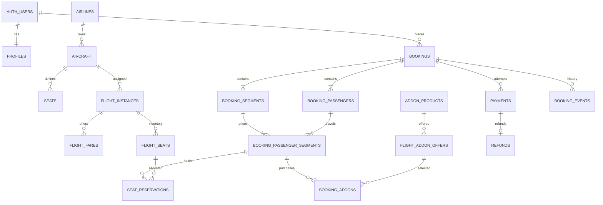

# Flight — đề xuất database tổng thể, RLS và index

**Bản nháp chờ duyệt — 29/10/2026. Chưa tạo bảng, policy, index hoặc migration trên Supabase.**

## A. Phạm vi và cách đọc

Thiết kế cho nhóm 3 người: Expo mobile, giao diện tiếng Anh, Supabase/PostgreSQL,
chuyến bay mẫu, thanh toán/hoàn tiền mô phỏng. Có một chiều, khứ hồi, nhiều chặng,
nhiều hành khách, hành lý, chọn ghế, giữ ghế và quản trị.

Đề xuất **22 bảng tự quản lý: 20 bảng public và 2 bảng private**.
`auth.users` và các bảng Supabase Storage do nền tảng quản lý không tính vào 22 bảng.
Không tạo lại bảng users/password/OTP/session. Mã xác nhận do Supabase Auth quản lý.

Quy ước:

- PK: khóa chính; FK: khóa ngoại; UQ: duy nhất, tự có index tương ứng.
- UUID dùng cho ID. `id` mặc định gen_random_uuid(), trừ profiles.id là ID Auth đã có.
- `?` sau tên trường: được NULL. Không có dấu ?: NOT NULL.
- `created_at`: timestamptz, server đặt now(); `updated_at`: timestamptz do trigger server cập nhật.
- Tất cả bảng có created_at. Bảng thay đổi được có updated_at; bảng sự kiện/audit chỉ ghi thêm.
- Tiền là bigint theo đơn vị nhỏ nhất của tiền tệ. Bản demo chỉ hỗ trợ **VND**,
  1 đơn vị lưu = 1 đồng; CHECK currency='VND', các khoản tiền không âm.
- Thời điểm tuyệt đối dùng timestamptz; ngày sinh dùng date. Sân bay lưu múi giờ IANA.
- Tên/cột enum dưới đây là đề xuất, chưa phải SQL đã triển khai.
- UUID không thay thế phân quyền. Biết ID đơn người khác không được quyền đọc/sửa đơn.

## B. Cơ chế quyền chung

Ba đối tượng: **G** = khách chưa đăng nhập (anon), **U** = khách hàng đăng nhập,
**A** = quản trị viên. A vẫn là request authenticated, có quyền admin được kiểm tra
phía database; không phải đưa service_role key vào app admin.

`uid` trong policy nghĩa là `(select auth.uid())`. `admin` nghĩa là kết quả
`(select private.is_admin())`, một helper chỉ tra quyền của người đang gọi.

Các kiểu policy tham chiếu trong từng bảng:

- **CAT:** G/U SELECT bản ghi is_active=true; A SELECT tất cả. INSERT/UPDATE chỉ A,
  UPDATE có cả USING admin và WITH CHECK admin. DELETE không cấp; dùng ngừng hoạt động.
- **PUB:** G/U SELECT nếu published_at IS NOT NULL của chuyến cha; A SELECT tất cả.
  Mọi ghi thông qua RPC quản trị có kiểm tra lịch, trạng thái và dữ liệu đã bán.
- **OWN:** U SELECT nếu bookings.user_id=uid qua booking_id; A SELECT tất cả.
  G bị chặn. Không cho U/A INSERT/UPDATE/DELETE trực tiếp: ghi qua RPC nghiệp vụ.
- **INTERNAL:** không cho G/U đọc/ghi bảng gốc; A chỉ đọc nếu được chỉ rõ. Dữ liệu
  cho khách được trả bằng hàm có danh sách cột an toàn; không mở bảng gốc để tiện UI.
- **PRIVATE:** schema private không được expose qua Data API, không cấp quyền bảng
  cho anon/authenticated; chỉ các helper/worker có quyền kiểm soát mới sử dụng.

**RLS và GRANT là hai lớp khác nhau.** Bật RLS cho cả 22 bảng, kể cả private để
phòng vệ. Chỉ cấp SELECT/INSERT/UPDATE trên bảng/cột thực sự cần. Không mặc định
GRANT ALL cho authenticated hoặc dùng policy USING(true) cho dữ liệu cá nhân.

Định nghĩa sở hữu cho bảng con, dạng biểu thức dự kiến:

```sql
exists (
  select 1 from public.bookings b
  where b.id = booking_id and b.user_id = (select auth.uid())
)
```

Tách policy SELECT own và SELECT admin; không thêm policy ALL dễ mở đường ghi.
Tính owned dựa trên booking thật; cột booking_id dư ở bảng sâu được bảo vệ bằng
FK ghép để không gắn một hành khách/ghế của đơn A vào booking_id của đơn B.

**Thiết kế RPC dự kiến:** wrapper public SECURITY INVOKER gọi hàm nghiệp vụ private
được kiểm soát quyền. Nếu hàm private cần SECURITY DEFINER để ghi các bảng vốn
không cho client ghi trực tiếp, nó phải tự kiểm tra auth.uid(), ownership/admin,
trạng thái và đầu vào; cố định search_path, ghi rõ schema, revoke EXECUTE mặc định
của PUBLIC và chỉ grant đúng vai trò cần. Không có hàm nhận user_id từ client rồi
tin luôn. Không để hàm đặc quyền tùy ý nhận tên bảng/SQL. Giữ giao dịch trong DB,
không tách giữ ghế/tạo đơn thành các request độc lập.

Tác vụ hết hạn chạy bằng worker/cron server chuyên biệt, không cấp hàm quét/xóa
toàn hệ thống cho client. Secret/service_role chỉ được dùng ở backend khi thật sự cần.

**Quyền hàm/schema dự kiến để migration không bị thiếu quyền:**
- private không expose trong Data API; có thể cấp USAGE schema cho vai trò cần gọi
  helper mà vẫn không cấp quyền đọc/ghi bất kỳ bảng private nào.
- private.is_admin(): EXECUTE cho anon/authenticated vì policy danh mục cũng cần
  gọi; trả false khi auth.uid() NULL. Chủ helper có quyền đọc user_roles thích hợp
  với RLS; người gọi không nhận quyền bảng đó ngoài thân hàm.
- public.search_flights/get_seat_map và helper đọc an toàn: EXECUTE cho
  anon/authenticated; helper chỉ trả dữ liệu công khai và các cột được duyệt.
- RPC checkout và helper private tương ứng: EXECUTE chỉ cho authenticated;
  helper tự kiểm tra uid, ownership/trạng thái dù gọi qua đường nào.
- admin RPC/helper private: EXECUTE cho authenticated nhưng phải kiểm tra admin
  trong hàm; có quyền EXECUTE không có nghĩa đã có quyền admin.
- worker/cron/cấp admin đầu tiên: chỉ vai trò server/scheduler được chỉ định;
  không grant anon/authenticated. Revoke EXECUTE mặc định từ PUBLIC trên mọi hàm mới.

## C. Các bảng và thuộc tính

### 01. public.profiles — hồ sơ khách hàng | TV1

**Thuộc tính**
- id: uuid, PK + FK auth.users.id; không tự sinh ID mới.
- full_name: text, 2–100 ký tự sau trim.
- contact_phone?: text, số liên hệ; nhập tay không có nghĩa đã xác minh SMS.
- avatar_path?: text, đường dẫn object trong Storage, không lưu URL ký tạm thời.
- created_at, updated_at: timestamptz.

**RLS/GRANT:** G không đọc/ghi. U SELECT hàng id=uid; UPDATE USING id=uid và
WITH CHECK id=uid. Chỉ cấp UPDATE(full_name,contact_phone,avatar_path), không cho
đổi id hoặc timestamps. A đọc hồ sơ khi cần hỗ trợ, không tùy ý sửa qua app.
INSERT do trigger tạo hồ sơ từ auth.users, hoặc RPC khởi tạo đúng uid. DELETE trực tiếp bị chặn.
Trigger tạo hồ sơ phải kiểm tra/làm sạch metadata và có test để tránh chặn đăng ký.

**Index:** PK(id) đủ cho truy vấn hồ sơ hiện tại; chưa thêm index tên/điện thoại.
**Ràng buộc:** không có role/password/OTP trong bảng này. Xử lý xóa tài khoản theo
luồng riêng; không cascade xóa các đơn lịch sử vì xóa profiles.

### 02. private.user_roles — quyền quản trị | TV3

**Thuộc tính**
- user_id: uuid, PK + FK auth.users.id.
- role: text, CHECK role='admin'; khách thông thường không cần một hàng role.
- granted_by?: uuid, FK auth.users.id; NULL cho lần khởi tạo admin đầu tiên.
- created_at, updated_at: timestamptz.

**RLS/GRANT:** PRIVATE. G/U/A không đọc/ghi bảng qua Data API. Helper is_admin
chỉ trả boolean về người gọi. Cấp/thu quyền qua thao tác server được audit, không
cho người dùng tự cập nhật role. Khởi tạo admin đầu tiên bằng quy trình quản trị DB.

**Index:** PK(user_id). Chưa index role vì mọi hàng hiện đều là admin;
index granted_by chỉ bổ sung nếu có truy vấn audit theo người cấp đáng kể.
**Ràng buộc:** không lấy quyền từ user_metadata; helper đọc dữ liệu quyền hiện hành.

### 03. public.airports — sân bay | TV3

**Thuộc tính**
- id: uuid PK.
- iata_code: text, UQ, 3 chữ cái in hoa.
- name: text; city: text; country_code: text, ISO 2 ký tự.
- timezone: text, ví dụ Asia/Ho_Chi_Minh, kiểm tra tên IANA hợp lệ khi ghi.
- is_active: boolean, mặc định true.
- created_at, updated_at: timestamptz.

**RLS/GRANT:** CAT. Hàng sân bay ngừng hoạt động vẫn được tham chiếu bởi lịch sử
đơn; khách đọc thông tin lịch sử qua snapshot trong đơn thay vì phải mở mọi hàng inactive.
**Index:** UQ(iata_code). Với seed nhỏ chưa cần index city/name. Khi autocomplete
ILIKE '%...%' có dữ liệu lớn, cân nhắc GIN pg_trgm trên biểu thức tìm kiếm chuẩn hóa,
không dùng B-tree thông thường rồi mặc định tin tìm chuỗi giữa sẽ nhanh.

### 04. public.airlines — hãng hàng không | TV3

**Thuộc tính**
- id: uuid PK; iata_code: text UQ, 2 ký tự chữ/số.
- name: text; logo_path?: text; is_active: boolean=true.
- created_at, updated_at: timestamptz.

**RLS/GRANT:** CAT. Không xóa cứng hãng được chuyến/đơn tham chiếu.
**Index:** UQ(iata_code); danh mục nhỏ không cần thêm index is_active riêng.

### 05. public.destinations — gợi ý điểm đến trên Home | TV3, TV1 sử dụng

**Thuộc tính**
- id: uuid PK; airport_id: uuid FK airports.id, sân bay gợi ý khi bấm điểm đến.
- slug: text UQ; title: text; description?: text; image_path?: text.
- is_featured: boolean=false; sort_order: integer=0; is_active: boolean=true.
- created_at, updated_at: timestamptz.

**RLS/GRANT:** CAT; chỉ hiện mục active có sân bay active; admin xem tất cả.
**Index:** UQ(slug); B-tree(airport_id) cho FK. Partial B-tree(sort_order,id)
WHERE is_active AND is_featured chỉ thêm khi truy vấn Home/dữ liệu thực tế cần.

### 06. public.aircraft — máy bay | TV3

**Thuộc tính**
- id: uuid PK; airline_id: uuid FK airlines.id.
- registration_code: text UQ, mã máy bay mô phỏng; model_name: text.
- is_active: boolean=true; created_at, updated_at: timestamptz.

**RLS/GRANT:** G/U không đọc bảng gốc; A SELECT. Ghi qua RPC quản trị, kiểm tra
chuyến đã mở bán/giữ ghế trước khi đổi cấu hình. Không cấp DELETE trực tiếp.
Sơ đồ ghế dành cho khách được trả qua get_seat_map, không cần lộ toàn bộ danh mục máy bay.
**Index:** UQ(registration_code); B-tree(airline_id) cho danh sách máy bay theo hãng/FK.
**Ràng buộc:** không lưu seat_count tự nhập; số ghế lấy từ seats/flight_seats để tránh lệch.

### 07. public.seats — sơ đồ ghế mẫu của máy bay | TV3

**Thuộc tính**
- id: uuid PK; aircraft_id: uuid FK aircraft.id.
- seat_code: text, ví dụ 12A; row_number: smallint>0; column_number: smallint>0.
- cabin_class: enum economy/premium_economy/business/first.
- position: enum window/middle/aisle; is_exit_row: boolean=false.
- is_active: boolean=true; created_at, updated_at: timestamptz.

**RLS/GRANT:** G/U không đọc/ghi bảng gốc; A SELECT; ghi qua RPC quản trị.
get_seat_map trả các thuộc tính vị trí cần thiết cho chuyến cụ thể.
**Index/ràng buộc:** UQ(aircraft_id,seat_code), UQ(aircraft_id,row_number,column_number).
Hai UQ đã hỗ trợ tra sơ đồ theo aircraft_id, không thêm index aircraft_id trùng.
Sơ đồ đã được chuyến mở bán dùng phải giữ ổn định hoặc thay bằng quy trình migration riêng.

### 08. public.flight_instances — từng chuyến bay theo thời điểm | TV3

**Thuộc tính**
- id: uuid PK; airline_id: uuid FK airlines.id; aircraft_id: uuid FK aircraft.id.
- flight_number: text, ví dụ VN123.
- departure_airport_id, arrival_airport_id: uuid FK airports.id.
- departure_at, arrival_at, sales_close_at: timestamptz.
- status: enum draft/scheduled/delayed/departed/arrived/cancelled.
- published_at?: timestamptz; created_at, updated_at: timestamptz.

**RLS/GRANT:** PUB. Công khai trạng thái của chuyến đã publish, kể cả cancelled
để tra thông tin; kết quả tìm vé chỉ lấy chuyến còn bán và chưa khởi hành.
Ghi qua RPC quản trị; không cấp direct INSERT/UPDATE/DELETE để lách kiểm tra lịch máy bay.

**Index**
- UQ(airline_id,flight_number,departure_at).
- B-tree(departure_airport_id,arrival_airport_id,departure_at,id)
  WHERE published_at IS NOT NULL AND status IN ('scheduled','delayed'): tìm tuyến/ngày.
- B-tree(aircraft_id,departure_at): kiểm tra lịch/khóa theo máy bay.
- B-tree(arrival_airport_id): tra chuyến đến và hỗ trợ FK.

**Ràng buộc:** departure_airport_id khác arrival_airport_id; arrival_at>departure_at.
sales_close_at<=departure_at; đề xuất demo đóng bán 60 phút trước giờ bay, cần nhóm
duyệt, không phải quy tắc mọi hãng. RPC kiểm tra aircraft.airline_id khớp airline_id
của chuyến; chưa mô hình hóa thuê máy bay/codeshare.
RPC khóa hàng aircraft khi lập/đổi lịch rồi kiểm tra giao khoảng, tránh hai admin cùng
tạo chuyến trùng máy bay. Index aircraft_id không tự bảo đảm chống lịch trùng.
Không đổi máy bay/sơ đồ khi đã có giữ ghế hoặc đơn hiệu lực bằng cập nhật trực tiếp.
Milestone đầu cũng từ chối đổi sân bay/giờ bay hoặc admin hủy chuyến khi còn đơn
pending/confirmed; cần xử lý các đơn trước. Không âm thầm hủy chuyến đã bán mà để
nguyên đơn confirmed; xử lý gián đoạn chuyến tự động là phần mở rộng.
Các chặng nối chuyến là nhiều hàng, không nhét cả hành trình vào một hàng flight_instances.

### 09. public.flight_fares — hạng vé và bảng giá của chuyến | TV3

**Thuộc tính**
- id: uuid PK; flight_id: uuid FK flight_instances.id.
- fare_code: text, ví dụ ECO_STANDARD; cabin_class: enum như seats; name: text.
- adult_base_amount, child_base_amount, infant_base_amount: bigint>=0.
- adult_tax_amount, child_tax_amount, infant_tax_amount: bigint>=0.
- adult_fee_amount, child_fee_amount, infant_fee_amount: bigint>=0.
- currency: text='VND'; baggage_allowance: jsonb.
- cancellation_allowed: boolean=false; cancellation_cutoff_minutes: integer>=0.
- cancellation_fee_amount: bigint>=0.
- is_active: boolean=true; created_at, updated_at: timestamptz.

**RLS/GRANT:** G/U SELECT fare active của chuyến đã publish; A SELECT tất cả.
Ghi qua RPC admin có kiểm tra giá/chính sách. Không xóa fare đã vào đơn.
**Index:** UQ(flight_id,fare_code), UQ(id,flight_id) để làm đích FK ghép.
Không cần thêm flight_id đơn vì UQ đầu đã có tiền tố này.
**Ràng buộc:** baggage_allowance có cấu trúc rõ: cabin_pieces, cabin_kg,
checked_pieces, checked_kg; số không âm. Không mặc định trẻ em/em bé có giá như người lớn.
Các fare cùng cabin dùng chung sức chứa ghế vật lý; không cộng số ghế lặp qua mỗi fare.

### 10. public.flight_seats — ghế vật lý trên một chuyến | TV3 tạo, TV2 sử dụng

**Thuộc tính**
- id: uuid PK; flight_id: uuid FK flight_instances.id; seat_id: uuid FK seats.id.
- seat_code: text; row_number, column_number: smallint>0; cabin_class, position: enum.
- is_exit_row: boolean; is_blocked: boolean=false.
- selection_fee_amount: bigint>=0; currency: text='VND'.
- created_at, updated_at: timestamptz.

**RLS/GRANT:** G/U không đọc bảng gốc. A SELECT; server/RPC quản trị tạo/cập nhật
theo quy tắc chuyến. get_seat_map(flight_id) trả vị trí, giá chọn ghế và trạng thái
available/held/booked/blocked, không trả ID khách/đơn của người khác.
Không lưu trạng thái đang giữ ở đây rồi cập nhật thêm một chỗ khác; trạng thái
giữ/đặt được suy ra từ seat_reservations, is_blocked dành cho ghế không bán.

**Index:** UQ(flight_id,seat_code), UQ(flight_id,seat_id), UQ(id,flight_id),
B-tree(seat_id) cho FK về sơ đồ mẫu. Render vài trăm ghế chưa cần thêm nhiều index cabin/vị trí.
**Ràng buộc:** tạo snapshot từ đúng aircraft của flight, không liên kết seat của
máy bay khác. Phần cấu hình đã bán không tùy ý thay đổi. id ghế theo chuyến khác
seat_id mẫu: ghế 12A của hai ngày bay có hai flight_seats.id khác nhau.

### 11. public.addon_products — loại dịch vụ/hành lý | TV3

**Thuộc tính**
- id: uuid PK; code: text UQ; name: text.
- category: enum baggage/meal/insurance_demo; description?: text.
- weight_kg?: numeric(6,2); is_active: boolean=true.
- created_at, updated_at: timestamptz.

**RLS/GRANT:** CAT. Insurance chỉ là mô phỏng, không xuất hợp đồng bảo hiểm.
**Index:** UQ(code); chưa index category boolean cho danh mục ít hàng.
**Ràng buộc:** baggage có weight_kg>0; loại khác không tự suy ra bảo hiểm thật.

### 12. public.flight_addon_offers — dịch vụ được bán trên chuyến | TV3

**Thuộc tính**
- id: uuid PK; flight_id: uuid FK flight_instances.id.
- product_id: uuid FK addon_products.id; unit_amount: bigint>=0; currency: text='VND'.
- max_quantity_per_passenger: smallint>0; is_active: boolean=true.
- created_at, updated_at: timestamptz.

**RLS/GRANT:** G/U SELECT offer active, product active, chuyến publish; A đọc tất cả.
INSERT/UPDATE admin-only, USING/WITH CHECK admin cho UPDATE; DELETE chặn, dùng inactive.
**Index:** UQ(flight_id,product_id), UQ(id,flight_id), B-tree(product_id) cho FK.
**Ràng buộc:** bản đầu chưa giới hạn tồn kho suất ăn toàn chuyến; max_quantity chỉ
giới hạn mỗi người. Nếu cần tồn kho dịch vụ phải bổ sung inventory/hold riêng.

### 13. public.bookings — đơn đặt vé | TV2, TV1 hiển thị

**Thuộc tính**
- id: uuid PK; user_id: uuid FK auth.users.id, người đặt.
- booking_code: text UQ, mã ngẫu nhiên không tuần tự; không dùng làm mật khẩu tra vé.
- create_request_id: uuid, do client tạo một lần rồi dùng lại khi retry tạo đơn.
- create_request_hash: text, server tính từ payload chuẩn hóa để phát hiện cùng key khác nội dung.
- trip_type: enum one_way/round_trip/multi_city.
- status: enum pending_payment/confirmed/cancelled/expired.
- contact_name, contact_email, contact_phone: text, snapshot liên hệ lúc đặt.
- currency: text='VND'; base_amount, tax_amount, fee_amount: bigint>=0.
- seat_amount, addon_amount, total_amount: bigint>=0.
- version: integer>=1, tăng khi đổi giá/lựa chọn để phát hiện thanh toán báo giá cũ.
- refund_policy_snapshot: jsonb, hợp đồng demo_v1 mô tả phạm vi hoàn các thành phần tiền.
- expires_at: timestamptz, hạn hoàn tất checkout khi pending.
- confirmed_at?, cancelled_at?: timestamptz; cancellation_reason?: text.
- created_at, updated_at: timestamptz.

**RLS/GRANT:** U SELECT user_id=uid; A SELECT tất cả; G không đọc.
Không cấp direct INSERT/UPDATE/DELETE cho U hoặc A. Mọi thay đổi qua RPC kiểm tra
người sở hữu, tính giá, giữ ghế và trạng thái. Không cho khách tự đổi total/status/user_id.

**Index**
- UQ(booking_code), UQ(user_id,create_request_id) chống tạo lặp theo người dùng.
- B-tree(user_id,created_at DESC,id DESC): lịch sử + phân trang keyset và policy ownership.
- B-tree(expires_at,id) WHERE status='pending_payment': worker xử lý hết hạn.
- Sau đo truy vấn admin mới cân nhắc (status,created_at DESC,id DESC) hoặc
  (created_at DESC,id DESC); không thêm cả hai ngay chỉ vì có dashboard.

**Ràng buộc:** total_amount>0 và total_amount=base+tax+fee+seat+addon. Bản đầu chưa
hỗ trợ đơn miễn phí; RPC từ chối tổng bằng 0 thay vì tạo đơn không thể trả tiền.
CHECK tổng chỉ so một hàng, không đủ kiểm tra dòng con: RPC phải tính lại trong transaction.
Giá/chính sách đã chốt khi tạo pending được bảo đảm trong TTL; sửa bảng giá chỉ áp
dụng đơn tạo mới. Đổi lựa chọn lấy giá hiện tại cho phần mới, tính lại và tăng
version, không gia hạn TTL. Thanh toán vẫn kiểm tra chuyến/fare còn được phép bán.
Lịch sử giá/điều kiện lưu snapshot; không đổi theo bảng giá hiện tại. Xóa user có đơn
bị RESTRICT ở bản đầu; nếu cần xóa tài khoản phải làm luồng ẩn danh hóa có chính sách lưu trữ.

### 14. public.booking_segments — các chuyến trong đơn | TV2

**Thuộc tính**
- id: uuid PK; booking_id: uuid FK bookings.id.
- flight_id: uuid FK flight_instances.id; fare_id: uuid FK flight_fares.id.
- journey_number: smallint>=1, ví dụ đi=1, về=2.
- leg_number: smallint>=1, thứ tự nối chuyến trong một journey.
- flight_snapshot: jsonb; fare_code_snapshot: text; cabin_class: enum.
- created_at, updated_at: timestamptz.

flight_snapshot định dạng: flight_number, airline_name/code, departure/arrival IATA,
airport_name, timezone và departure_at/arrival_at đã chốt; không dùng JSON thay FK.

**RLS/GRANT:** OWN. Ghi chỉ qua RPC của đơn, khóa sửa sau confirmed.
**Index/ràng buộc:** UQ(booking_id,journey_number,leg_number), UQ(id,booking_id,flight_id),
B-tree(flight_id), B-tree(fare_id). FK(fare_id,flight_id) → flight_fares(id,flight_id)
bảo đảm fare thuộc đúng chuyến. UQ có booking_id đầu đã giúp liệt kê chặng theo đơn.

### 15. public.booking_passengers — hành khách snapshot trong đơn | TV2

**Thuộc tính**
- id: uuid PK; booking_id: uuid FK bookings.id; ordinal: smallint>=1.
- given_names, family_name: text; date_of_birth: date.
- nationality_code?: text, ISO 2 ký tự.
- document_type?: enum national_id/passport; document_number?: text.
- document_expiry_date?: date; document_issuer_country?: text.
- created_at, updated_at: timestamptz.

**RLS/GRANT:** OWN, không công khai thông tin hành khách. Nhập/sửa qua RPC khi đơn
còn pending; không cập nhật snapshot đã confirmed bằng form sửa hồ sơ cá nhân.
**Index/ràng buộc:** UQ(booking_id,ordinal), UQ(id,booking_id). Chưa index tên hoặc
số giấy tờ. Giấy tờ chỉ bắt buộc theo hành trình/chính sách demo đã duyệt; không thu
thập tràn lan. Không dùng full_name trong profile làm hành khách bắt buộc vì có thể mua hộ.

### 16. public.booking_passenger_segments — giá của từng người trên từng chặng | TV2

**Thuộc tính**
- id: uuid PK; booking_id: uuid; segment_id: uuid; passenger_id: uuid; flight_id: uuid.
- passenger_type: enum adult/child/infant, server tính tại ngày bay theo chính sách.
- requires_seat: boolean; accompanying_passenger_id?: uuid, người lớn đi kèm em bé.
- base_amount, tax_amount, fee_amount: bigint>=0; currency: text='VND'.
- allowance_snapshot: jsonb; cancellation_rules_snapshot: jsonb.
- created_at, updated_at: timestamptz.

**RLS/GRANT:** OWN; giá/loại hành khách đều do RPC tính, không nhận số tiền do client chốt.
**Index/ràng buộc:** UQ(segment_id,passenger_id), UQ(id,booking_id,flight_id),
B-tree(booking_id), B-tree(passenger_id). FK(segment_id,booking_id,flight_id) →
booking_segments(id,booking_id,flight_id); FK(passenger_id,booking_id) →
booking_passengers(id,booking_id); FK(accompanying_passenger_id,booking_id) → cùng bảng.

allowance_snapshot có số kiện/kg đã mua; cancellation_rules_snapshot gồm allowed,
cutoff_minutes và fee_amount đã chốt. Trẻ em/em bé có thể thay loại ở ngày bay khác
nhau nên loại hành khách đặt ở bảng này, không chỉ ở profile.
RPC kiểm tra người đi kèm là người lớn cùng chặng, khác chính em bé; người lớn không
được gắn số em bé vượt chính sách. Nếu infant không có ghế thì không tạo giữ ghế.
booking_id/flight_id lặp có chủ đích để FK ghép bảo vệ liên kết và hỗ trợ RLS.

### 17. public.seat_reservations — giữ/đặt ghế | TV2

**Thuộc tính**
- id: uuid PK; booking_id: uuid; passenger_segment_id: uuid; flight_id: uuid.
- flight_seat_id: uuid; status: enum held/confirmed/released/expired.
- selection_amount: bigint>=0, giá chốt cho ghế hiện tại; currency: text='VND'.
- expires_at?: timestamptz, bắt buộc khi held; confirmed_at?, released_at?: timestamptz.
- created_at, updated_at: timestamptz.

**RLS/GRANT:** OWN. Không cho U/A ghi trực tiếp. Chỉ RPC giữ/đổi/nhả/xác nhận ghế.
Sơ đồ công khai lấy từ get_seat_map; không mở SELECT mọi reservation cho khách.

**Index**
- UNIQUE(flight_seat_id) WHERE status IN ('held','confirmed'): chặn trùng ghế hiệu lực.
- UNIQUE(passenger_segment_id) WHERE status IN ('held','confirmed'): một người/chặng một ghế.
- B-tree(booking_id): RLS, liệt kê/giải phóng ghế của đơn.
- B-tree(expires_at,id) WHERE status='held': quét giữ ghế hết hạn.

**Ràng buộc:** FK(passenger_segment_id,booking_id,flight_id) →
booking_passenger_segments(id,booking_id,flight_id); FK(flight_seat_id,flight_id) →
flight_seats(id,flight_id). Kiểm tra cabin, ghế blocked, tuổi/ghế exit row trong RPC.

**Không dùng expires_at>now() trong predicate unique index.** Hết thời gian không
tự làm hàng held biến mất khỏi unique index. RPC phải khóa inventory flight_seats
theo thứ tự ổn định, expire các hold cũ liên quan, rồi giữ ghế mới trong cùng transaction;
worker dọn các hàng còn lại. Trước confirmed phải kiểm tra hạn bằng thời gian server.
Mọi reservation held dùng cùng expires_at với booking, không có TTL riêng trôi
lệch; đổi ghế không kéo dài hạn. Trước/SAU khi chờ khóa, kiểm tra bằng clock_timestamp(),
không chỉ now() vì now() giữ nguyên giá trị thời điểm bắt đầu transaction.

Để không bán quá chỗ khi khách chưa chọn ghế, bản đề xuất tự giữ một ghế phù hợp
cho mọi passenger_segment requires_seat=true khi tạo pending booking. Khách chọn
ghế khác là đổi giữ ghế nguyên tử; tự phân ghế không thu phí lựa chọn. Chỉ ghế do
khách chủ động chọn có thể tính selection_amount theo bảng giá.

### 18. public.booking_addons — dịch vụ đã chọn trong đơn | TV2

**Thuộc tính**
- id: uuid PK; booking_id: uuid; passenger_segment_id: uuid; flight_id: uuid.
- offer_id: uuid; product_name_snapshot: text; category_snapshot: enum.
- weight_kg_snapshot?: numeric(6,2); quantity: smallint>0.
- unit_amount: bigint>=0; total_amount: bigint, generated quantity*unit_amount.
- currency: text='VND'; created_at, updated_at: timestamptz.

**RLS/GRANT:** OWN; thay đổi qua RPC khi pending, kiểm tra offer/quyền và max quantity.
**Index/ràng buộc:** UQ(passenger_segment_id,offer_id), B-tree(booking_id), B-tree(offer_id).
FK(passenger_segment_id,booking_id,flight_id) → passenger_segments tương ứng;
FK(offer_id,flight_id) → flight_addon_offers(id,flight_id). Không được mua offer của
chuyến khác bằng cách đổi ID. Các thông tin snapshot không đổi khi product đổi tên/giá.

### 19. public.payments — từng lần thanh toán mô phỏng | TV2

**Thuộc tính**
- id: uuid PK; booking_id: uuid FK bookings.id.
- idempotency_key: uuid; request_hash: text do server tạo.
- booking_version: integer>=1; amount: bigint>0; currency: text='VND'.
- provider: text CHECK provider='mock'; provider_reference?: text.
- status: enum pending/succeeded/failed/cancelled.
- failure_code?: text, mã lỗi an toàn; paid_at?: timestamptz.
- created_at, updated_at: timestamptz.

**RLS/GRANT:** OWN; client không INSERT, UPDATE thành succeeded hoặc xóa lần thanh toán.
Không có raw gateway payload, card number hay CVV trong bảng. Không dùng role admin
để bỏ qua xác nhận trạng thái: admin cũng phải gọi RPC đã kiểm tra.

**Index/ràng buộc**
- UQ(booking_id,idempotency_key); B-tree(booking_id,created_at DESC,id DESC).
- UNIQUE(booking_id) WHERE status='succeeded': tối đa một lần thu thành công cho một đơn.
- UNIQUE(booking_id) WHERE status='pending': tối đa một lần đang xử lý.
- UNIQUE(provider,provider_reference) khi reference có giá trị; Postgres UQ cho phép nhiều NULL.

RPC khóa booking, kiểm tra ownership, version, còn hạn và amount=total trên server.
Cùng key khác payload bị từ chối. Kết quả mô phỏng không được chạy bằng một endpoint
đánh dấu mọi đơn thành công; bản production không được bật mock provider.
Trạng thái thanh toán thành công đến trễ sau expiry không được xác nhận mất ghế;
bản demo từ chối trước khi ghi succeeded hoặc đi luồng đối soát mô phỏng đã chốt.

### 20. public.refunds — hoàn tiền mô phỏng khi hủy | TV2

**Thuộc tính**
- id: uuid PK; booking_id: uuid; payment_id: uuid FK payments.id.
- idempotency_key: uuid; amount: bigint>0; currency: text='VND'.
- reason: text; status: enum pending/succeeded/failed; provider_reference?: text.
- completed_at?: timestamptz; created_at, updated_at: timestamptz.

**RLS/GRANT:** OWN; chỉ server tạo/xử lý khi chính sách hủy và payment hợp lệ.
**Index/ràng buộc:** UQ(payment_id), UQ(booking_id,idempotency_key),
UQ(provider_reference) cho giá trị khác NULL. UQ(id,booking_id) trên payments được
bổ sung làm đích FK(payment_id,booking_id) để refund thuộc đúng đơn; payment_id
FK ghép cùng booking_id thay cho FK đơn nếu dùng ràng buộc ghép.

Bản đầu chỉ có một yêu cầu hoàn cho toàn đơn: số tiền có thể trừ phí hủy theo
snapshot, không hỗ trợ nhiều lần hoàn từng hành khách/chặng. Retry cập nhật cùng
refund thay vì tạo thêm. payment vẫn succeeded sau khi refund, để unique success
không vô tình mở đường thu lần hai; số đã hoàn lấy từ refunds. Nếu tiền hoàn bằng
0 thì chỉ ghi sự kiện hủy, không tạo refund amount=0. Kiểm tra amount<=payment.amount
và currency giống nhau trong transaction; CHECK một bảng không đủ cho so chéo bảng.

**Công thức demo_v1 đề xuất:** khi mọi chặng đều cho phép hủy và chưa vượt cutoff,
refund_amount = max(0, booking.total_amount - tổng cancellation_fee_amount của
tất cả booking_passenger_segments). Bản demo hoàn cả base/tax/fee/ghế/addon rồi
trừ phí hủy theo từng người-chặng. Quy tắc các khoản được hoàn và cách cộng phí
lưu trong bookings.refund_policy_snapshot; mức phí/cutoff lưu ở passenger_segments.
Đây là chính sách mô phỏng chờ duyệt, không áp dụng mặc định cho vé hãng thật.
Đơn pending chưa thu tiền chỉ giải phóng ghế, không tạo refund. Retry hủy đơn đã
cancelled trả kết quả hủy/refund cũ, kể cả hoàn 0, không append sự kiện/thu phí lần hai.
Request_id của cancel ghi trong metadata sự kiện hủy; cùng đơn đã cancelled không
thực hiện thêm nghiệp vụ dù client retry bằng key khác.

### 21. public.booking_events — lịch sử đơn | TV2, TV1/TV3 hiển thị

**Thuộc tính**
- id: uuid PK; booking_id: uuid FK bookings.id; actor_user_id?: uuid FK auth.users.id.
- event_type: text có tập giá trị được kiểm soát.
- from_status?, to_status?: enum booking_status.
- customer_visible: boolean; safe_message: text; metadata: jsonb, whitelist trường an toàn.
- created_at: timestamptz; không có updated_at, sự kiện chỉ ghi thêm.

**RLS/GRANT:** U SELECT khi sở hữu đơn VÀ customer_visible=true; A SELECT tất cả.
G không đọc. Không cấp INSERT/UPDATE/DELETE cho app; server append cùng transaction
với thay đổi nghiệp vụ. Không đặt mật khẩu/token/giấy tờ/thông tin debug nội bộ vào metadata.
**Index:** B-tree(booking_id,created_at DESC,id DESC). actor_user_id index chỉ thêm
nếu có truy vấn/cleanup FK thường xuyên; hiện dùng private audit cho tìm theo admin.

### 22. private.admin_audit_logs — nhật ký quản trị | TV3

**Thuộc tính**
- id: uuid PK; actor_user_id?: uuid FK auth.users.id.
- action: text, ví dụ flight.publish, fare.update, role.grant.
- entity_type: text; entity_id?: uuid; safe_changes: jsonb, whitelist.
- created_at: timestamptz, chỉ ghi thêm; không có updated_at.

**RLS/GRANT:** PRIVATE. A chỉ xem qua hàm admin có xác thực, không mở raw table
qua Data API. Worker/RPC quản trị ghi; không cấp sửa/xóa nhật ký cho app.
**Index:** B-tree(actor_user_id,created_at DESC,id DESC) và
B-tree(entity_type,entity_id,created_at DESC,id DESC). entity_id là tham chiếu đa loại,
không phải FK giả trỏ cùng lúc vào mọi bảng; validate loại/ID lúc ghi.

## D. Quan hệ và quy tắc nhất quán



ERD trên thể hiện quan hệ chính, không thay thế toàn bộ FK trong từ điển dữ liệu.
Hai FK departure/arrival đều về airports; destinations.airport_id cũng về airports.

- Với đơn mới, phải có ít nhất một chặng và một hành khách; FK không tự đảm bảo
  có ít nhất một hàng con, RPC kiểm tra khi tạo/xác nhận đơn.
- Mỗi hành khách có đúng một passenger_segment cho mỗi chặng trong đơn; RPC bảo
  đảm tích hợp lệ, không chỉ dựa vào UQ chống trùng.
- Ràng buộc `UNIQUE(id,booking_id,flight_id)` và tương tự nhìn có vẻ dư vì id đã
  duy nhất, nhưng cần làm đích FK ghép; đây là chi phí được chọn để bảo vệ liên kết.
- Hàng tài chính/hành khách không cascade delete từ danh mục. RESTRICT xóa chuyến,
  fare, máy bay hoặc user đã được tham chiếu, trừ luồng quản trị đã thiết kế riêng.
- Sau confirmed: không sửa giá/hành khách/dịch vụ trực tiếp. Đổi vé là milestone
  khác; hủy đi qua trạng thái và refund, không xóa đơn để giả như chưa từng tồn tại.
- Dữ liệu seed chỉ dùng thông tin cá nhân giả, không đưa giấy tờ thật vào Git.

## E. Các RPC cần đi kèm, chưa triển khai trong bản duyệt

1. search_flights(criteria): tìm ngày theo giờ địa phương sân bay đi rồi quy đổi
   thành [start_utc,end_utc); không bọc departure_at bằng date() trong điều kiện chính.
2. get_seat_map(flight_id): chỉ công khai trạng thái ghế và phí, không trả người giữ.
3. create_booking(request_id,itinerary,passengers,contact): lấy uid từ request,
   kiểm tra dữ liệu và giá server, tạo snapshot và tự giữ ghế, all-or-nothing.
4. update_checkout(booking_id,expected_version,changes): chỉ pending, đổi hành lý/ghế,
   tính lại tổng, tăng version. Không reset TTL vô hạn khi người dùng đổi lựa chọn.
5. start_mock_payment(booking_id,expected_version,idempotency_key,scenario): kiểm
   tra server; mô phỏng thành công/thất bại/hủy. Giá và owner không do client truyền.
6. cancel_booking(booking_id,request_id,reason): kiểm tra chính sách snapshot và
   toàn bộ hành trình. Bản đầu hủy toàn đơn; có một chặng không đủ điều kiện thì từ chối.
7. expire_bookings_and_holds: server worker/cron; xử lý từng lô, khóa theo thứ tự.
8. admin_*: quản trị chuyến, sơ đồ, giá và cấp quyền, kiểm tra admin/audit trong DB.

RPC quote/booking/payment khóa booking trước rồi khóa flight_seats theo thứ tự
ổn định (ví dụ UUID tăng dần) ở mọi đường code. Expire/cancel dùng cùng thứ tự để
hạn chế deadlock. Khi cạnh tranh xảy ra phải trả lỗi ghế/giá hết hiệu lực có thể hiểu được.

Hạn giữ đề xuất **10 phút**, chờ nhóm duyệt; ngày giờ và TTL luôn lấy server.
expires_at = min(thời gian thực server + 10 phút, sales_close_at sớm nhất trong đơn).
Mọi chặng phải publish, trạng thái cho phép bán, chưa tới sales_close_at khi tạo,
đổi checkout và xác nhận thanh toán. Đọc thời gian thực lại sau khi lấy đủ khóa;
đơn hết hạn hoặc tới cutoff khi chờ khóa phải bị từ chối. Tăng version không vượt hạn.
Policy tuổi đề xuất cho dữ liệu demo: infant<2, child từ 2 đến <12, adult>=12 tại
giờ địa phương ngày khởi hành; infant đi cùng người lớn và không chiếm ghế trong
bản đầu. Đây là quy tắc mô phỏng, không khẳng định đúng chính sách mọi hãng.

## F. Index: vì sao thêm, vì sao chưa thêm

- PK/UQ tự tạo index; không lặp lại các index đó bằng tên khác.
- Index FK phía bảng con không tự được tạo trong mọi trường hợp; đánh giá từng
  FK và dùng index/UQ có tiền tố phù hợp. Composite UQ không phải lúc nào cũng thay
  được index cho cột nằm ở giữa/cuối; ví dụ flight_fares id/flight có vai trò khác nhau.
- Các truy vấn RLS sở hữu đi từ booking_id PK của bookings rồi kiểm tra user_id;
  lịch sử đơn dùng thêm index user_id/created_at. Không viết policy join vòng giữa
  hai bảng mà mỗi bên lại phải gọi policy bên kia.
- Partial index held/pending giúp số dòng nhỏ và phục vụ worker. Điều kiện lọc
  truy vấn cần phù hợp predicate; không index riêng mọi boolean/status ít phân biệt.
- UNIQUE ghế vừa là tính toàn vẹn vừa là index. Không thay transaction bằng index.
- GIN/trigram cho tìm chuỗi, GiST cho khoảng lịch máy bay, BRIN theo thời gian chỉ
  xem xét sau khi có truy vấn/khối lượng phù hợp; bản đầu chưa cần toàn bộ chúng.
- Không index số giấy tờ để tiện nếu chưa có nhu cầu được duyệt; tăng bề mặt dữ liệu
  và chi phí ghi mà không giúp luồng đặt vé chính.
- Các index ở bản nháp là giả thuyết thiết kế. Sau seed phải dùng EXPLAIN (ANALYZE,
  BUFFERS), kiểm tra pg_stat_statements/advisor và thời gian truy vấn, không cam kết
  nhanh chỉ vì đã thêm index. Đo trong môi trường phù hợp, không chạy ANALYZE truy
  vấn ghi trên dữ liệu thật chỉ để thử hiệu năng.

## G. Các trường hợp bắt buộc test sau khi được duyệt

- Guest đọc danh mục hợp lệ nhưng không đọc được hồ sơ/đơn/thanh toán.
- Người A không đọc/sửa đơn/hành khách/ghế của B bằng ID trực tiếp hoặc RPC.
- Khách không tự cấp admin; admin chưa được phép đánh dấu payment succeeded trực tiếp.
- Không ghép passenger/segment/offer/seat thuộc khác booking hoặc flight.
- Hai giao dịch giữ cùng ghế: chỉ một bên thành công; hết hạn có thể bán lại an toàn.
- Đủ người có ghế mới tạo/xác nhận đơn; infant lap không tạo ghế thừa.
- Cùng request_id retry cho ra cùng đơn, cùng key khác payload bị từ chối.
- Giá đổi, version cũ, hết hạn giữa checkout và payment không làm sai tổng hoặc trùng ghế.
- Thanh toán và expiry/cancel chạy đồng thời cho ra trạng thái thống nhất.
- Hủy đúng chính sách giải phóng ghế và chỉ có một refund hợp lệ.
- Máy bay có lịch giao nhau bị từ chối ngay cả khi hai admin cùng tạo.
- Test RLS bằng JWT/role khách thật; test dưới postgres/service_role không chứng minh RLS hoạt động.
- View/truy vấn báo cáo tôn trọng quyền; nếu dùng view trên bảng nhạy cảm cần
  security_invoker phù hợp và GRANT tối thiểu, không mặc định view tuân RLS của người gọi.

## H. Phân công và các quyết định chờ duyệt

- TV1: profiles và trải nghiệm tìm/đọc đơn. Tiếp nhận hợp đồng dữ liệu chung.
- TV2 (bạn): bookings, booking_segments, booking_passengers,
  booking_passenger_segments, seat_reservations, booking_addons, payments,
  refunds, booking_events; phối hợp flight_seats với TV3.
- TV3: danh mục, chuyến/giá/inventory, quyền admin và audit, điều phối migration.

Các đề xuất cần duyệt: 22 bảng; VND duy nhất trước; hold 10 phút và tự cấp ghế khi
chưa chọn; infant lap; hủy/hoàn toàn đơn thay vì từng hành khách; không bán/hoàn
thật; sales cutoff 60 phút trước bay; công thức hoàn demo_v1; chưa hỗ trợ tổng tiền 0.
Chưa thêm mã giảm giá, tích điểm, notifications, favorites, vé do hãng xuất,
nhiều currency hoặc số tồn kho suất ăn. Có thể bổ sung ở milestone sau.

## Nguồn kỹ thuật

Đây là thiết kế riêng cho Flight, tham khảo cơ chế PostgreSQL/Supabase; không phải
schema chính thức từ một hãng vé hay kết quả benchmark.

- https://supabase.com/docs/guides/auth/managing-user-data
- https://supabase.com/docs/guides/database/postgres/row-level-security
- https://supabase.com/docs/guides/database/postgres/indexes
- https://supabase.com/docs/guides/database/functions
- https://www.postgresql.org/docs/current/ddl-constraints.html
- https://www.postgresql.org/docs/current/indexes-partial.html
- https://www.postgresql.org/docs/current/functions-datetime.html
