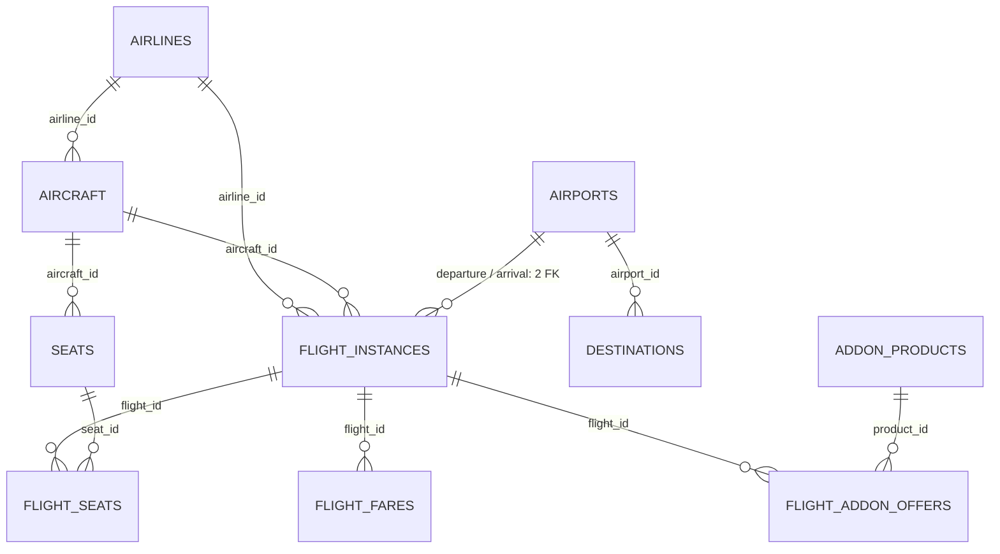
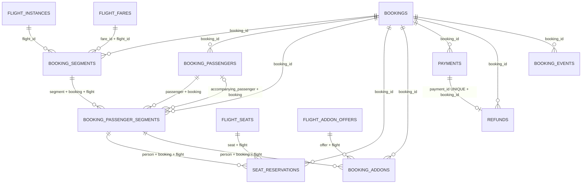
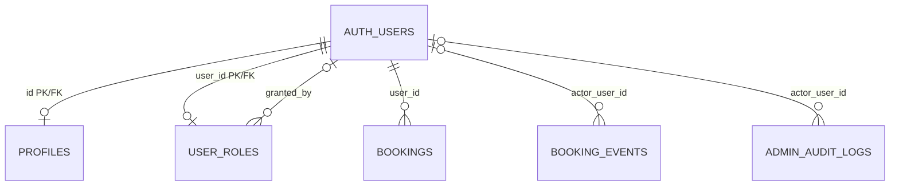

# Hiểu database Flight từ đầu đến cuối

Đối chiếu trực tiếp metadata của project **flight-dev**, ngày **01/11/2026**.
Snapshot có **22 bảng nghiệp vụ, 258 cột, 77 index, 36 khóa ngoại và 31 RLS policy**.
Đây là tài liệu giải thích cấu trúc đã tồn tại; không chạy thay đổi schema/dữ liệu.
Hai migration nền tảng: [database_foundation](../supabase/migrations/20261029142657_database_foundation.sql)
và [harden_database_access](../supabase/migrations/20261029143747_harden_database_access.sql).

## Đọc trước: một ví dụ để nối mọi thứ lại

An đăng nhập và đặt khứ hồi SGN–HAN cho An và Bình. Cả hai đều cần ghế riêng.
Đây là ví dụ giả để học, không phải bản ghi người dùng đang có trên database.

1. Hãng, sân bay, máy bay, ghế mẫu là dữ liệu danh mục.
2. Hai lần bay đi/về là **2 flight_instances**; giá chọn từ **flight_fares**.
3. Đơn chung của An là **1 bookings**. Người đặt lấy từ auth.users, không từ bảng hành khách.
4. Hai chiều thẳng của đơn là **2 booking_segments**. Nếu một chiều nối chuyến thì có nhiều leg trong cùng journey.
5. Hai người thực sự bay là **2 booking_passengers**; Bình không cần tài khoản đăng nhập riêng.
6. Hai người × hai chặng thành **4 booking_passenger_segments**. Đây là nơi tách giá, loại tuổi, ghế và dịch vụ theo từng người/chặng.
7. Mỗi người/chặng có ghế riêng: bình thường sẽ có **4 reservations hiệu lực**. Người không chiếm ghế như infant theo quy tắc demo không tạo ghế riêng.
8. Hành lý mua thêm chỉ cho Bình ở chiều đi là một **booking_addons** gắn đúng người/chặng đó.
9. Thanh toán thất bại rồi thử lại là nhiều **payments**, không phải nhiều đơn. Hoàn tiền nằm trong **refunds**.
10. Những thay đổi của đơn thành **booking_events**; thao tác quản trị cần ghi vào **admin_audit_logs**.

Các số lượng trên mô tả đơn hợp lệ theo nghiệp vụ. FK/UQ không tự tạo các hàng con;
RPC tạo đơn nguyên tử còn phải triển khai để bảo đảm đủ dữ liệu và giá/ghế nhất quán.

## Từ vựng cần biết

- **Bảng / hàng / cột**: ví dụ bookings là sổ đơn; mỗi hàng là một đơn; booking_code là một cột của đơn.
- **PK (khóa chính)**: mã nhận diện duy nhất của một hàng. Hầu hết là id UUID; user_roles dùng user_id làm PK.
- **FK (khóa ngoại)**: cột/bộ cột phải trỏ tới bản ghi thật ở bảng cha. Nó bảo vệ liên kết, không tự quyết định ai được đọc.
- **UQ/UNIQUE**: cấm trùng một giá trị hoặc tổ hợp. Hai hàng có thể trùng một thành phần nếu cả tổ hợp vẫn khác nhau.
- **CHECK**: điều kiện dữ liệu phải thỏa, như amount>0 hoặc hai sân bay khác nhau.
- **NOT NULL**: không được thiếu giá trị. Với text, nó không tự cấm chuỗi rỗng; cần CHECK/validation riêng.
- **DEFAULT**: giá trị DB dùng nếu INSERT bỏ qua cột; không phải cứ sau này thay đổi gì DB cũng tự tính lại.
- **GENERATED STORED**: DB tự tính và lưu kết quả biểu thức. booking_addons.total_amount thuộc loại này; bookings.total_amount thì không.
- **Index**: như mục lục để tìm/sắp xếp nhanh hơn. Có chi phí bộ nhớ và chi phí ghi; không nên thêm cho mọi cột tùy ý.
- **Index ghép**: sắp theo thứ tự nhiều cột. Ví dụ (user_id,created_at DESC,id DESC) phù hợp đọc lịch sử một user từ mới đến cũ.
- **Partial index**: chỉ chứa hàng đúng điều kiện WHERE, ví dụ chỉ đơn đang pending_payment.
- **Unique index**: ngoài hỗ trợ tìm kiếm còn cấm trùng. PK/UQ tự có index; FK ở bảng con không tự có index trong mọi trường hợp.
- **Snapshot**: bản chụp giá/tên/chính sách lúc mua để giữ lịch sử. Không phải backup database và không thay FK thật.

Tài liệu gốc về [index](https://supabase.com/docs/guides/database/postgres/indexes)
và [PK/UQ/FK/CHECK](https://www.postgresql.org/docs/17/ddl-constraints.html).

## Kiểu dữ liệu và quy ước chung

- uuid: mã định danh, không phải số thứ tự. booking_code/seat_code/fare_code phục vụ hiển thị hoặc nghiệp vụ khác UUID.
- text: chuỗi. boolean: true/false. smallint/integer: số nguyên; bigint: số nguyên lớn dùng cho tiền VND.
- numeric(6,2): số có phần lẻ, ở đây dùng cho kg. jsonb: đối tượng JSON có cấu trúc linh hoạt.
- date: ngày lịch, không có giờ. timestamptz lưu một mốc thời gian, không giữ tên múi giờ IANA đã nhập;
  muốn hiển thị theo sân bay cần dùng timezone của sân bay, không cộng tay 7 giờ.
- Tiền dùng số đồng VND nguyên và CHECK currency=VND. Các cột tax/fee là số tiền, không phải phần trăm.
- created_at mặc định now(); updated_at được trigger cập nhật. booking_events và admin_audit_logs chỉ có created_at.
- nullable trong mục cột nghĩa là DB cho phép NULL; không có nghĩa UI lúc nào cũng phải hỏi người dùng.
- Mặc định FK là NO ACTION khi xóa nếu không ghi khác: cha đang được tham chiếu thường không xóa được.
  profiles có ON DELETE CASCADE; một số FK auth.users ghi RESTRICT rõ ràng. Không có cascade xóa cả lịch sử đơn.
- Tất cả 77 index hiện là B-tree. 22 là PK, 30 là UQ constraint, 25 được tạo riêng; trong 25 đó có 4 partial UNIQUE cho ghế/thanh toán.
- Các mô tả index nói mục đích thiết kế, không phải kết quả benchmark. Planner có chọn dùng index hay không còn tùy query/dữ liệu, cần EXPLAIN để kiểm chứng.

## RLS: đọc theo quyền của request, không theo màn hình đang mở

- **G / khách**: request API với role anon, chưa đăng nhập app.
- **U / user**: role authenticated; auth.uid() lấy ID người dùng từ phiên hợp lệ của request.
- **A / admin app**: vẫn là authenticated, nhưng private.is_admin() trả true do có hàng admin trong private.user_roles.
- **Owner/Developer Supabase Dashboard**: quyền quản trị nền tảng của nhóm; khác A ở trên. SQL Editor/role đặc quyền có thể đọc vượt phạm vi RLS của app.

Hai lớp phải cùng cho phép:

1. **GRANT** cho phép thực hiện SELECT/INSERT/UPDATE/DELETE trên bảng hoặc cột.
2. **RLS policy** quyết định những hàng nào được phép với thao tác đó.

Có GRANT SELECT nhưng RLS không khớp thường trả danh sách rỗng. Không có GRANT thì thường báo permission denied.
RLS không phải cơ chế lọc cột: profiles dùng column-level GRANT để giới hạn đúng ba cột được UPDATE.

**USING** kiểm tra hàng được nhìn thấy/tác động; **WITH CHECK** kiểm tra hàng mới sau INSERT/UPDATE.
Policy UPDATE của profiles dùng cả hai để giữ đúng chủ sở hữu. Không có policy phù hợp là mặc định từ chối cho role chịu RLS.
Table owner/postgres/role có BYPASSRLS và hàm SECURITY DEFINER có quyền phù hợp là trường hợp đặc quyền;
không lấy kết quả SELECT bằng SQL Editor làm bằng chứng rằng user app cũng đọc được.

Migration thứ hai gộp hai policy đọc cũ thành **read_authorized** trên 17 bảng; đó là OR điều kiện đọc user/khách với điều kiện admin,
không phải mở quyền ghi. Ba bảng inventory giữ **inventory_read_admin**; profiles có thêm **profile_update_own**.
Hai bảng private không có policy/client table grant. private có USAGE cho helper nhưng USAGE không đồng nghĩa được đọc bảng.

RLS/grants được liệt kê chính xác ở từng bảng bên dưới. Bản SQL là snapshot dùng để đọc hiểu, **không dán chạy lại lên cloud**.
Tham khảo [RLS chính thức](https://supabase.com/docs/guides/database/postgres/row-level-security).

## Quan hệ: đọc sơ đồ như thế nào

- 1–1 thường được làm bằng FK có UNIQUE/PK ở bảng con; ví dụ profiles.id → auth.users.id.
- 1–n: FK ở bảng con, nhiều con được tham chiếu cùng cha. Cha không chứa một mảng ID con.
- n–n: cần bảng nối. flight_addon_offers nối chuyến với sản phẩm; booking_passenger_segments nối người với chặng.
- Trong sơ đồ, || là đúng một, o| là không hoặc một, o{ là không hoặc nhiều.
  Cha có 0 hàng con vẫn có thể hợp lệ ở mức SQL; yêu cầu tối thiểu một chặng/hành khách thuộc RPC.

### Danh mục và chuyến bay



### Đơn, người/chặng, ghế, dịch vụ, thanh toán



SEAT_RESERVATIONS có thể có nhiều hàng lịch sử cho một ghế/người–chặng;
partial UNIQUE chỉ giới hạn tập held/confirmed, không đổi quan hệ lịch sử thành 1–1.

### Tài khoản, hồ sơ, quyền và người thao tác



AUTH_USERS là auth.users do Supabase quản lý, không tính vào 22 bảng tự tạo.
Hồ sơ và role không phải hai bảng chứa mật khẩu. entity_id trong audit không có FK đa bảng nên không vẽ đường FK giả.

## Mục lục 22 bảng

1. [public.profiles — Hồ sơ tài khoản](#public-profiles)
2. [private.user_roles — Quyền admin của app](#private-user-roles)
3. [public.airports — Danh mục sân bay](#public-airports)
4. [public.airlines — Danh mục hãng bay](#public-airlines)
5. [public.destinations — Nội dung điểm đến trên trang chủ](#public-destinations)
6. [public.aircraft — Từng chiếc máy bay](#public-aircraft)
7. [public.seats — Sơ đồ ghế mẫu trên máy bay](#public-seats)
8. [public.flight_instances — Một lần bay vào ngày giờ cụ thể](#public-flight-instances)
9. [public.flight_fares — Các gói giá của một chuyến](#public-flight-fares)
10. [public.flight_seats — Kho ghế riêng của từng chuyến](#public-flight-seats)
11. [public.addon_products — Danh mục sản phẩm dịch vụ](#public-addon-products)
12. [public.flight_addon_offers — Dịch vụ được bán và giá theo chuyến](#public-flight-addon-offers)
13. [public.bookings — Đầu đơn đặt vé](#public-bookings)
14. [public.booking_segments — Các chặng mà đơn mua](#public-booking-segments)
15. [public.booking_passengers — Những người thực sự bay trong đơn](#public-booking-passengers)
16. [public.booking_passenger_segments — Mỗi người trên mỗi chặng](#public-booking-passenger-segments)
17. [public.seat_reservations — Lịch sử giữ/đặt/nhả ghế](#public-seat-reservations)
18. [public.booking_addons — Dịch vụ mà từng người/chặng đã mua](#public-booking-addons)
19. [public.payments — Các lần thử thanh toán mô phỏng](#public-payments)
20. [public.refunds — Khoản hoàn tiền mô phỏng](#public-refunds)
21. [public.booking_events — Dòng thời gian của đơn](#public-booking-events)
22. [private.admin_audit_logs — Nhật ký thao tác quản trị](#private-admin-audit-logs)

<a id="public-profiles"></a>

## 01. public.profiles — Hồ sơ tài khoản

**Lưu gì và vì sao tách bảng:** Lưu thông tin hiển thị/liên hệ của một tài khoản đăng nhập. Không lưu mật khẩu và không đại diện cho tất cả hành khách mà người này mua vé hộ.

**Ví dụ:** Tài khoản của An có tên Nguyễn An, số liên hệ và ảnh đại diện.

### Thuộc tính — đủ 6 cột

- `id` (`uuid`; NOT NULL): PK đồng thời FK auth.users.id; dùng đúng UID của tài khoản, không sinh UUID profile độc lập.
- `full_name` (`text`; NOT NULL): Họ tên hiển thị của tài khoản; không thay thế tên của từng hành khách trên đơn.
- `contact_phone` (`text`; có thể NULL): Số điện thoại liên hệ; đây là dữ liệu liên hệ, không phải định danh đăng nhập qua SMS.
- `avatar_path` (`text`; có thể NULL): Đường dẫn hoặc khóa ảnh đại diện; không chứa trực tiếp dữ liệu ảnh.
- `created_at` (`timestamp with time zone`; NOT NULL; DEFAULT `now()`): Thời điểm tạo bản ghi, mặc định lấy giờ database khi INSERT.
- `updated_at` (`timestamp with time zone`; NOT NULL; DEFAULT `now()`): Thời điểm sửa gần nhất; trigger đặt lại theo clock_timestamp() khi UPDATE.

### Quan hệ và khóa ngoại

- `profiles_id_fkey`: `FOREIGN KEY (id) REFERENCES auth.users(id) ON DELETE CASCADE`.
  Mỗi hàng con phải có đúng một hàng cha hợp lệ cho bộ khóa này.

Không có FK từ một trong 22 bảng khác trỏ vào bảng này tại thời điểm đọc schema.

### Index — đủ 1 index hiện có

- **`profiles_pkey`** — Index PK: đảm bảo khóa chính duy nhất/không NULL và tìm trực tiếp bản ghi theo khóa.
  `CREATE UNIQUE INDEX profiles_pkey ON public.profiles USING btree (id)`.

### RLS và quyền thực tế

- SELECT / read_authorized / authenticated: đọc hàng id=auth.uid() hoặc private.is_admin()=true. Khách chưa đăng nhập không có SELECT.
- UPDATE / profile_update_own: cả USING và WITH CHECK đều yêu cầu id=auth.uid(). Chỉ được GRANT UPDATE ba cột full_name, contact_phone, avatar_path; không sửa id/created_at/updated_at.
- Admin app đọc được mọi profile nhưng cũng chỉ sửa profile của chính mình theo policy này. INSERT do trigger tạo; app không có INSERT hoặc DELETE trực tiếp.

**GRANT trên toàn bảng cho client:** `authenticated`: `SELECT`.
**GRANT riêng theo cột:** `authenticated` `UPDATE`(`full_name`); `authenticated` `UPDATE`(`contact_phone`); `authenticated` `UPDATE`(`avatar_path`).

**Policy đúng như metadata đang có:**

- `profile_update_own` — `UPDATE`, TO `authenticated`, PERMISSIVE.
  USING:

```sql
(id = ( SELECT auth.uid() AS uid))
```
  WITH CHECK:

```sql
(id = ( SELECT auth.uid() AS uid))
```
- `read_authorized` — `SELECT`, TO `authenticated`, PERMISSIVE.
  USING:

```sql
(( SELECT private.is_admin() AS is_admin) OR (id = ( SELECT auth.uid() AS uid)))
```

### Điểm cần hiểu, tránh nhầm

- id vừa là PK vừa là FK tới auth.users.id: mỗi user có tối đa một profile. Trigger tạo profile sau INSERT auth.users và đã backfill user có sẵn; đây là cơ chế giúp đạt quan hệ 1–1 khi dùng bình thường.
- full_name có CHECK 2–100 ký tự sau trim; contact_phone nếu có phải đúng mẫu + và 8–15 chữ số, chữ số đầu khác 0. Không giống số liên hệ nội địa được phép ở module checkout.
- ON DELETE CASCADE chỉ áp dụng từ auth.users xuống profile. Xóa tài khoản có đơn vẫn có thể bị FK của bookings/user_roles/logs chặn.
- Trigger hiện chỉ khởi tạo profile, không đồng bộ mọi lần sửa Auth user_metadata. Màn sửa hồ sơ TV1 hiện có dùng metadata; việc nối hồ sơ vào public.profiles là bước tích hợp riêng.

**CHECK đang thực thi trong SQL:**

- `CHECK (((contact_phone IS NULL) OR (contact_phone ~ '^\+[1-9][0-9]{7,14}$'::text)))`.
- `CHECK (((length(btrim(full_name)) >= 2) AND (length(btrim(full_name)) <= 100)))`.

**Trigger gắn trên bảng:** `CREATE TRIGGER set_updated_at BEFORE UPDATE ON public.profiles FOR EACH ROW EXECUTE FUNCTION private.set_updated_at()`.


<a id="private-user-roles"></a>

## 02. private.user_roles — Quyền admin của app

**Lưu gì và vì sao tách bảng:** Lưu những tài khoản được cấp quyền admin trong ứng dụng. Không phải danh sách thành viên Organization Supabase.

**Ví dụ:** Một hàng user_id=UID của người quản trị, role=admin, granted_by=UID người cấp quyền.

### Thuộc tính — đủ 5 cột

- `user_id` (`uuid`; NOT NULL): PK đồng thời FK auth.users.id: tài khoản nhận quyền admin, không phải người cấp.
- `role` (`text`; NOT NULL): Quyền trong app. Hiện CHECK chỉ cho giá trị admin; khách hàng thường không cần một hàng customer.
- `granted_by` (`uuid`; có thể NULL): ID tài khoản đã cấp quyền; có thể NULL nếu chưa ghi người cấp hoặc thao tác hệ thống.
- `created_at` (`timestamp with time zone`; NOT NULL; DEFAULT `now()`): Thời điểm tạo bản ghi, mặc định lấy giờ database khi INSERT.
- `updated_at` (`timestamp with time zone`; NOT NULL; DEFAULT `now()`): Thời điểm sửa gần nhất; trigger đặt lại theo clock_timestamp() khi UPDATE.

### Quan hệ và khóa ngoại

- `user_roles_granted_by_fkey`: `FOREIGN KEY (granted_by) REFERENCES auth.users(id) ON DELETE RESTRICT`.
  Bộ khóa có cột cho phép NULL: liên kết này có thể không có ở một hàng.
- `user_roles_user_id_fkey`: `FOREIGN KEY (user_id) REFERENCES auth.users(id) ON DELETE RESTRICT`.
  Mỗi hàng con phải có đúng một hàng cha hợp lệ cho bộ khóa này.

Không có FK từ một trong 22 bảng khác trỏ vào bảng này tại thời điểm đọc schema.

### Index — đủ 1 index hiện có

- **`user_roles_pkey`** — Index PK: đảm bảo khóa chính duy nhất/không NULL và tìm trực tiếp bản ghi theo khóa.
  `CREATE UNIQUE INDEX user_roles_pkey ON private.user_roles USING btree (user_id)`.

### RLS và quyền thực tế

- RLS bật nhưng không có policy cho app; cũng không có GRANT SELECT/INSERT/UPDATE/DELETE cho anon/authenticated.
- Khách, người dùng và admin app đều không đọc/ghi bảng trực tiếp. Không có policy trong trường hợp này là chủ đích chặn truy cập, không phải quên bảo vệ.
- Chỉ code server/trigger/hàm private được cấp đúng quyền mới thao tác. Riêng is_admin() chỉ trả về boolean cho uid hiện tại, không mở cả bảng user_roles.

**GRANT trên toàn bảng cho client:** không có.
**Policy:** không có; app không được truy cập trực tiếp bảng private này.

### Điểm cần hiểu, tránh nhầm

- user_id là PK nên mỗi tài khoản có tối đa một hàng quyền trong thiết kế hiện tại; role chỉ nhận admin. Không có hàng thường được hiểu là không phải admin.
- granted_by và user_id cùng tham chiếu auth.users nhưng mang hai vai trò khác nhau: người được cấp và người cấp.
- private.is_admin() đọc bảng này theo auth.uid() của request; không tin user_metadata.role do người dùng tự sửa.

**CHECK đang thực thi trong SQL:**

- `CHECK ((role = 'admin'::text))`.

**Trigger gắn trên bảng:** `CREATE TRIGGER set_updated_at BEFORE UPDATE ON private.user_roles FOR EACH ROW EXECUTE FUNCTION private.set_updated_at()`.


<a id="public-airports"></a>

## 03. public.airports — Danh mục sân bay

**Lưu gì và vì sao tách bảng:** Lưu sân bay để chọn nơi đi/nơi đến và xác định múi giờ/quốc gia.

**Ví dụ:** SGN là Tân Sơn Nhất, HAN là Nội Bài; ví dụ minh họa, không phải seed đã có trên DB.

### Thuộc tính — đủ 9 cột

- `id` (`uuid`; NOT NULL; DEFAULT `gen_random_uuid()`): Mã UUID của bản ghi; khóa chính dùng để các bảng khác tham chiếu, không phải mã hiển thị cho khách.
- `iata_code` (`text`; NOT NULL): Mã IATA: sân bay có 3 chữ cái, hãng có 2 ký tự theo CHECK tương ứng.
- `name` (`text`; NOT NULL): Tên hiển thị của đối tượng; UUID/code mới là định danh để nối dữ liệu.
- `city` (`text`; NOT NULL): Tên thành phố của sân bay, ví dụ Hà Nội.
- `country_code` (`text`; NOT NULL): Mã quốc gia 2 chữ cái viết hoa, ví dụ VN.
- `timezone` (`text`; NOT NULL): Tên múi giờ IANA của sân bay, ví dụ Asia/Ho_Chi_Minh; không phải chuỗi cộng 7 giờ tự nhập.
- `is_active` (`boolean`; NOT NULL; DEFAULT `true`): Cờ còn sử dụng trong danh mục/lựa chọn mới; false giữ lại bản ghi để không làm hỏng dữ liệu lịch sử.
- `created_at` (`timestamp with time zone`; NOT NULL; DEFAULT `now()`): Thời điểm tạo bản ghi, mặc định lấy giờ database khi INSERT.
- `updated_at` (`timestamp with time zone`; NOT NULL; DEFAULT `now()`): Thời điểm sửa gần nhất; trigger đặt lại theo clock_timestamp() khi UPDATE.

### Quan hệ và khóa ngoại

Bảng này không có FK đi ra. Các bảng con trỏ tới nó được liệt kê ngay dưới.

**Các bảng đang trỏ vào bảng này:**
- `public.destinations`: `airport_id`. Đây là phía bảng con của quan hệ.
- `public.flight_instances`: `arrival_airport_id`. Đây là phía bảng con của quan hệ.
- `public.flight_instances`: `departure_airport_id`. Đây là phía bảng con của quan hệ.

### Index — đủ 2 index hiện có

- **`airports_iata_code_key`** — Một mã IATA chỉ chỉ tới một sân bay.
  `CREATE UNIQUE INDEX airports_iata_code_key ON public.airports USING btree (iata_code)`.
- **`airports_pkey`** — Index PK: đảm bảo khóa chính duy nhất/không NULL và tìm trực tiếp bản ghi theo khóa.
  `CREATE UNIQUE INDEX airports_pkey ON public.airports USING btree (id)`.

### RLS và quyền thực tế

- SELECT / read_authorized / anon,authenticated: khách/người dùng đọc hàng is_active=true; admin app đọc tất cả hàng kể cả inactive.
- INSERT: chỉ authenticated có private.is_admin()=true được thêm; WITH CHECK xác minh quyền.
- UPDATE: chỉ admin app; USING kiểm tra quyền sửa hàng cũ và WITH CHECK kiểm tra quyền trên hàng sau sửa.
- DELETE: không cấp cho app, kể cả admin. Ngừng sử dụng bằng is_active=false để giữ quan hệ lịch sử.

**GRANT trên toàn bảng cho client:** `anon`: `SELECT`; `authenticated`: `INSERT`; `authenticated`: `SELECT`; `authenticated`: `UPDATE`.

**Policy đúng như metadata đang có:**

- `catalogue_insert_admin` — `INSERT`, TO `authenticated`, PERMISSIVE.
  WITH CHECK:

```sql
( SELECT private.is_admin() AS is_admin)
```
- `catalogue_update_admin` — `UPDATE`, TO `authenticated`, PERMISSIVE.
  USING:

```sql
( SELECT private.is_admin() AS is_admin)
```
  WITH CHECK:

```sql
( SELECT private.is_admin() AS is_admin)
```
- `read_authorized` — `SELECT`, TO `anon`, `authenticated`, PERMISSIVE.
  USING:

```sql
(is_active OR ( SELECT private.is_admin() AS is_admin))
```

### Điểm cần hiểu, tránh nhầm

- iata_code đúng 3 chữ hoa và duy nhất; country_code đúng 2 chữ hoa. Trigger xác thực timezone có trong pg_timezone_names.
- Một sân bay có thể có nhiều nội dung destinations và nhiều chuyến xuất phát/đến. Hai FK trên flight_instances cùng trỏ vào bảng này nhưng có ý nghĩa đi/đến khác nhau.

**CHECK đang thực thi trong SQL:**

- `CHECK ((country_code ~ '^[A-Z]{2}$'::text))`.
- `CHECK ((iata_code ~ '^[A-Z]{3}$'::text))`.
- `CHECK ((length(btrim(name)) > 0))`.

**Trigger gắn trên bảng:** `CREATE TRIGGER set_updated_at BEFORE UPDATE ON public.airports FOR EACH ROW EXECUTE FUNCTION private.set_updated_at()`; `CREATE TRIGGER validate_airport_timezone BEFORE INSERT OR UPDATE OF timezone ON public.airports FOR EACH ROW EXECUTE FUNCTION private.validate_airport_timezone()`.


<a id="public-airlines"></a>

## 04. public.airlines — Danh mục hãng bay

**Lưu gì và vì sao tách bảng:** Lưu hãng, mã IATA và logo.

**Ví dụ:** Một hãng có iata_code VN và tên hiển thị tương ứng.

### Thuộc tính — đủ 7 cột

- `id` (`uuid`; NOT NULL; DEFAULT `gen_random_uuid()`): Mã UUID của bản ghi; khóa chính dùng để các bảng khác tham chiếu, không phải mã hiển thị cho khách.
- `iata_code` (`text`; NOT NULL): Mã IATA: sân bay có 3 chữ cái, hãng có 2 ký tự theo CHECK tương ứng.
- `name` (`text`; NOT NULL): Tên hiển thị của đối tượng; UUID/code mới là định danh để nối dữ liệu.
- `logo_path` (`text`; có thể NULL): Đường dẫn/khóa logo hãng bay.
- `is_active` (`boolean`; NOT NULL; DEFAULT `true`): Cờ còn sử dụng trong danh mục/lựa chọn mới; false giữ lại bản ghi để không làm hỏng dữ liệu lịch sử.
- `created_at` (`timestamp with time zone`; NOT NULL; DEFAULT `now()`): Thời điểm tạo bản ghi, mặc định lấy giờ database khi INSERT.
- `updated_at` (`timestamp with time zone`; NOT NULL; DEFAULT `now()`): Thời điểm sửa gần nhất; trigger đặt lại theo clock_timestamp() khi UPDATE.

### Quan hệ và khóa ngoại

Bảng này không có FK đi ra. Các bảng con trỏ tới nó được liệt kê ngay dưới.

**Các bảng đang trỏ vào bảng này:**
- `public.aircraft`: `airline_id`. Đây là phía bảng con của quan hệ.
- `public.flight_instances`: `airline_id`. Đây là phía bảng con của quan hệ.

### Index — đủ 2 index hiện có

- **`airlines_iata_code_key`** — Một mã IATA hãng chỉ xuất hiện một lần.
  `CREATE UNIQUE INDEX airlines_iata_code_key ON public.airlines USING btree (iata_code)`.
- **`airlines_pkey`** — Index PK: đảm bảo khóa chính duy nhất/không NULL và tìm trực tiếp bản ghi theo khóa.
  `CREATE UNIQUE INDEX airlines_pkey ON public.airlines USING btree (id)`.

### RLS và quyền thực tế

- SELECT / read_authorized / anon,authenticated: khách/người dùng đọc hàng is_active=true; admin app đọc tất cả hàng kể cả inactive.
- INSERT: chỉ authenticated có private.is_admin()=true được thêm; WITH CHECK xác minh quyền.
- UPDATE: chỉ admin app; USING kiểm tra quyền sửa hàng cũ và WITH CHECK kiểm tra quyền trên hàng sau sửa.
- DELETE: không cấp cho app, kể cả admin. Ngừng sử dụng bằng is_active=false để giữ quan hệ lịch sử.

**GRANT trên toàn bảng cho client:** `anon`: `SELECT`; `authenticated`: `INSERT`; `authenticated`: `SELECT`; `authenticated`: `UPDATE`.

**Policy đúng như metadata đang có:**

- `catalogue_insert_admin` — `INSERT`, TO `authenticated`, PERMISSIVE.
  WITH CHECK:

```sql
( SELECT private.is_admin() AS is_admin)
```
- `catalogue_update_admin` — `UPDATE`, TO `authenticated`, PERMISSIVE.
  USING:

```sql
( SELECT private.is_admin() AS is_admin)
```
  WITH CHECK:

```sql
( SELECT private.is_admin() AS is_admin)
```
- `read_authorized` — `SELECT`, TO `anon`, `authenticated`, PERMISSIVE.
  USING:

```sql
(is_active OR ( SELECT private.is_admin() AS is_admin))
```

### Điểm cần hiểu, tránh nhầm

- iata_code gồm 2 chữ hoa/chữ số và duy nhất. Một hãng có nhiều máy bay và nhiều chuyến cụ thể.

**CHECK đang thực thi trong SQL:**

- `CHECK ((iata_code ~ '^[A-Z0-9]{2}$'::text))`.
- `CHECK ((length(btrim(name)) > 0))`.

**Trigger gắn trên bảng:** `CREATE TRIGGER set_updated_at BEFORE UPDATE ON public.airlines FOR EACH ROW EXECUTE FUNCTION private.set_updated_at()`.


<a id="public-destinations"></a>

## 05. public.destinations — Nội dung điểm đến trên trang chủ

**Lưu gì và vì sao tách bảng:** Lưu tiêu đề, ảnh, nội dung giới thiệu và thứ tự quảng bá một điểm đến gắn với sân bay. Không phải bảng lịch bay.

**Ví dụ:** Nội dung Khám phá Hà Nội gắn airport_id của HAN.

### Thuộc tính — đủ 11 cột

- `id` (`uuid`; NOT NULL; DEFAULT `gen_random_uuid()`): Mã UUID của bản ghi; khóa chính dùng để các bảng khác tham chiếu, không phải mã hiển thị cho khách.
- `airport_id` (`uuid`; NOT NULL): ID sân bay mà nội dung điểm đến này gắn vào.
- `slug` (`text`; NOT NULL): Tên định danh dạng URL, ví dụ ha-noi; phải duy nhất.
- `title` (`text`; NOT NULL): Tiêu đề nội dung điểm đến hiển thị trên giao diện.
- `description` (`text`; có thể NULL): Nội dung mô tả; không phải điều kiện tính giá.
- `image_path` (`text`; có thể NULL): Đường dẫn/khóa ảnh minh họa điểm đến.
- `is_featured` (`boolean`; NOT NULL; DEFAULT `false`): Có ưu tiên đưa vào danh sách điểm đến nổi bật hay không.
- `sort_order` (`integer`; NOT NULL; DEFAULT `0`): Số dùng sắp thứ tự hiển thị; không phải ID.
- `is_active` (`boolean`; NOT NULL; DEFAULT `true`): Cờ còn sử dụng trong danh mục/lựa chọn mới; false giữ lại bản ghi để không làm hỏng dữ liệu lịch sử.
- `created_at` (`timestamp with time zone`; NOT NULL; DEFAULT `now()`): Thời điểm tạo bản ghi, mặc định lấy giờ database khi INSERT.
- `updated_at` (`timestamp with time zone`; NOT NULL; DEFAULT `now()`): Thời điểm sửa gần nhất; trigger đặt lại theo clock_timestamp() khi UPDATE.

### Quan hệ và khóa ngoại

- `destinations_airport_id_fkey`: `FOREIGN KEY (airport_id) REFERENCES airports(id)`.
  Mỗi hàng con phải có đúng một hàng cha hợp lệ cho bộ khóa này.

Không có FK từ một trong 22 bảng khác trỏ vào bảng này tại thời điểm đọc schema.

### Index — đủ 3 index hiện có

- **`destinations_airport_idx`** — Tìm mọi nội dung điểm đến theo một sân bay; hỗ trợ truy vết FK.
  `CREATE INDEX destinations_airport_idx ON public.destinations USING btree (airport_id)`.
- **`destinations_pkey`** — Index PK: đảm bảo khóa chính duy nhất/không NULL và tìm trực tiếp bản ghi theo khóa.
  `CREATE UNIQUE INDEX destinations_pkey ON public.destinations USING btree (id)`.
- **`destinations_slug_key`** — Không có hai nội dung dùng cùng slug.
  `CREATE UNIQUE INDEX destinations_slug_key ON public.destinations USING btree (slug)`.

### RLS và quyền thực tế

- SELECT / read_authorized / anon,authenticated: khách/người dùng đọc hàng is_active=true và sân bay liên quan cũng active; admin app đọc tất cả hàng kể cả inactive.
- INSERT: chỉ authenticated có private.is_admin()=true được thêm; WITH CHECK xác minh quyền.
- UPDATE: chỉ admin app; USING kiểm tra quyền sửa hàng cũ và WITH CHECK kiểm tra quyền trên hàng sau sửa.
- DELETE: không cấp cho app, kể cả admin. Ngừng sử dụng bằng is_active=false để giữ quan hệ lịch sử.

**GRANT trên toàn bảng cho client:** `anon`: `SELECT`; `authenticated`: `INSERT`; `authenticated`: `SELECT`; `authenticated`: `UPDATE`.

**Policy đúng như metadata đang có:**

- `destinations_insert_admin` — `INSERT`, TO `authenticated`, PERMISSIVE.
  WITH CHECK:

```sql
( SELECT private.is_admin() AS is_admin)
```
- `destinations_update_admin` — `UPDATE`, TO `authenticated`, PERMISSIVE.
  USING:

```sql
( SELECT private.is_admin() AS is_admin)
```
  WITH CHECK:

```sql
( SELECT private.is_admin() AS is_admin)
```
- `read_authorized` — `SELECT`, TO `anon`, `authenticated`, PERMISSIVE.
  USING:

```sql
((is_active AND (EXISTS ( SELECT 1
   FROM airports a
  WHERE ((a.id = destinations.airport_id) AND a.is_active)))) OR ( SELECT private.is_admin() AS is_admin))
```

### Điểm cần hiểu, tránh nhầm

- slug duy nhất và đúng dạng chữ thường/số nối bằng dấu gạch ngang. airport_id không UNIQUE: một sân bay có thể có nhiều bài/chiến dịch giới thiệu.
- Với khách, cả nội dung và sân bay liên quan đều phải is_active=true mới đọc được.

**CHECK đang thực thi trong SQL:**

- `CHECK ((slug ~ '^[a-z0-9]+(-[a-z0-9]+)*$'::text))`.

**Trigger gắn trên bảng:** `CREATE TRIGGER set_updated_at BEFORE UPDATE ON public.destinations FOR EACH ROW EXECUTE FUNCTION private.set_updated_at()`.


<a id="public-aircraft"></a>

## 06. public.aircraft — Từng chiếc máy bay

**Lưu gì và vì sao tách bảng:** Lưu một chiếc máy bay cụ thể thuộc hãng nào, mã đăng ký và dòng máy bay.

**Ví dụ:** Hai chiếc A320 khác registration_code là hai hàng aircraft khác nhau.

### Thuộc tính — đủ 7 cột

- `id` (`uuid`; NOT NULL; DEFAULT `gen_random_uuid()`): Mã UUID của bản ghi; khóa chính dùng để các bảng khác tham chiếu, không phải mã hiển thị cho khách.
- `airline_id` (`uuid`; NOT NULL): ID hãng bay liên quan.
- `registration_code` (`text`; NOT NULL): Mã đăng ký của chiếc máy bay mô phỏng; duy nhất toàn bảng.
- `model_name` (`text`; NOT NULL): Tên dòng máy bay, ví dụ Airbus A320. Nhiều chiếc có thể cùng model.
- `is_active` (`boolean`; NOT NULL; DEFAULT `true`): Cờ còn sử dụng trong danh mục/lựa chọn mới; false giữ lại bản ghi để không làm hỏng dữ liệu lịch sử.
- `created_at` (`timestamp with time zone`; NOT NULL; DEFAULT `now()`): Thời điểm tạo bản ghi, mặc định lấy giờ database khi INSERT.
- `updated_at` (`timestamp with time zone`; NOT NULL; DEFAULT `now()`): Thời điểm sửa gần nhất; trigger đặt lại theo clock_timestamp() khi UPDATE.

### Quan hệ và khóa ngoại

- `aircraft_airline_id_fkey`: `FOREIGN KEY (airline_id) REFERENCES airlines(id)`.
  Mỗi hàng con phải có đúng một hàng cha hợp lệ cho bộ khóa này.

**Các bảng đang trỏ vào bảng này:**
- `public.flight_instances`: `aircraft_id`. Đây là phía bảng con của quan hệ.
- `public.seats`: `aircraft_id`. Đây là phía bảng con của quan hệ.

### Index — đủ 3 index hiện có

- **`aircraft_airline_idx`** — Liệt kê máy bay của hãng; hỗ trợ FK airline_id.
  `CREATE INDEX aircraft_airline_idx ON public.aircraft USING btree (airline_id)`.
- **`aircraft_pkey`** — Index PK: đảm bảo khóa chính duy nhất/không NULL và tìm trực tiếp bản ghi theo khóa.
  `CREATE UNIQUE INDEX aircraft_pkey ON public.aircraft USING btree (id)`.
- **`aircraft_registration_code_key`** — Không có hai chiếc máy bay dùng cùng mã đăng ký.
  `CREATE UNIQUE INDEX aircraft_registration_code_key ON public.aircraft USING btree (registration_code)`.

### RLS và quyền thực tế

- SELECT / inventory_read_admin / authenticated: chỉ private.is_admin()=true đọc bảng gốc. User thường có GRANT SELECT nhưng RLS lọc hết hàng; anon không có GRANT SELECT.
- INSERT/UPDATE/DELETE: app không có quyền trực tiếp, kể cả admin; dự kiến admin RPC kiểm tra lịch/sơ đồ/dữ liệu đã bán rồi mới ghi.
- Dữ liệu này phục vụ quản trị, không phải dữ liệu công khai cho khách.

**GRANT trên toàn bảng cho client:** `authenticated`: `SELECT`.

**Policy đúng như metadata đang có:**

- `inventory_read_admin` — `SELECT`, TO `authenticated`, PERMISSIVE.
  USING:

```sql
( SELECT private.is_admin() AS is_admin)
```

### Điểm cần hiểu, tránh nhầm

- Không lưu seat_count tự nhập; sơ đồ thật lấy từ seats/flight_seats để tránh số ghế bị lệch.
- FK riêng lẻ hiện chưa tự buộc flight_instances.airline_id khớp aircraft.airline_id, cũng chưa chống hai lịch bay giao nhau. Đó là kiểm tra/khóa của admin RPC sau này.

**Trigger gắn trên bảng:** `CREATE TRIGGER set_updated_at BEFORE UPDATE ON public.aircraft FOR EACH ROW EXECUTE FUNCTION private.set_updated_at()`.


<a id="public-seats"></a>

## 07. public.seats — Sơ đồ ghế mẫu trên máy bay

**Lưu gì và vì sao tách bảng:** Lưu từng ghế vật lý trong sơ đồ một chiếc máy bay. Không phải tình trạng ghế của một ngày bay.

**Ví dụ:** Chiếc máy bay A có ghế mẫu 12A; nó có thể phục vụ nhiều chuyến/ngày.

### Thuộc tính — đủ 11 cột

- `id` (`uuid`; NOT NULL; DEFAULT `gen_random_uuid()`): Mã UUID của bản ghi; khóa chính dùng để các bảng khác tham chiếu, không phải mã hiển thị cho khách.
- `aircraft_id` (`uuid`; NOT NULL): ID một chiếc máy bay cụ thể, không chỉ tên dòng máy bay.
- `seat_code` (`text`; NOT NULL): Tên ghế hiển thị như 12A; chỉ có ý nghĩa cùng máy bay/chuyến tương ứng.
- `row_number` (`smallint`; NOT NULL): Số hàng ghế, phải lớn hơn 0.
- `column_number` (`smallint`; NOT NULL): Thứ tự cột/vị trí ngang của ghế trong sơ đồ, phải lớn hơn 0.
- `cabin_class` (`cabin_class`; NOT NULL): Hạng khoang: economy, premium_economy, business hoặc first.
  Giá trị enum: `economy`, `premium_economy`, `business`, `first`.
- `position` (`seat_position`; NOT NULL): Loại vị trí: window/cửa sổ, middle/giữa hoặc aisle/lối đi.
  Giá trị enum: `window`, `middle`, `aisle`.
- `is_exit_row` (`boolean`; NOT NULL; DEFAULT `false`): Cờ ghế ở hàng cửa thoát hiểm; điều kiện người được chọn ghế do nghiệp vụ kiểm tra sau.
- `is_active` (`boolean`; NOT NULL; DEFAULT `true`): Cờ còn sử dụng trong danh mục/lựa chọn mới; false giữ lại bản ghi để không làm hỏng dữ liệu lịch sử.
- `created_at` (`timestamp with time zone`; NOT NULL; DEFAULT `now()`): Thời điểm tạo bản ghi, mặc định lấy giờ database khi INSERT.
- `updated_at` (`timestamp with time zone`; NOT NULL; DEFAULT `now()`): Thời điểm sửa gần nhất; trigger đặt lại theo clock_timestamp() khi UPDATE.

### Quan hệ và khóa ngoại

- `seats_aircraft_id_fkey`: `FOREIGN KEY (aircraft_id) REFERENCES aircraft(id)`.
  Mỗi hàng con phải có đúng một hàng cha hợp lệ cho bộ khóa này.

**Các bảng đang trỏ vào bảng này:**
- `public.flight_seats`: `seat_id`. Đây là phía bảng con của quan hệ.

### Index — đủ 3 index hiện có

- **`seats_aircraft_id_row_number_column_number_key`** — Trong một máy bay không có hai ghế cùng ô hàng/cột.
  `CREATE UNIQUE INDEX seats_aircraft_id_row_number_column_number_key ON public.seats USING btree (aircraft_id, row_number, column_number)`.
- **`seats_aircraft_id_seat_code_key`** — Trong một máy bay không lặp tên ghế, nhưng máy bay khác có thể cùng ghế 12A.
  `CREATE UNIQUE INDEX seats_aircraft_id_seat_code_key ON public.seats USING btree (aircraft_id, seat_code)`.
- **`seats_pkey`** — Index PK: đảm bảo khóa chính duy nhất/không NULL và tìm trực tiếp bản ghi theo khóa.
  `CREATE UNIQUE INDEX seats_pkey ON public.seats USING btree (id)`.

### RLS và quyền thực tế

- SELECT / inventory_read_admin / authenticated: chỉ private.is_admin()=true đọc bảng gốc. User thường có GRANT SELECT nhưng RLS lọc hết hàng; anon không có GRANT SELECT.
- INSERT/UPDATE/DELETE: app không có quyền trực tiếp, kể cả admin; dự kiến admin RPC kiểm tra lịch/sơ đồ/dữ liệu đã bán rồi mới ghi.
- Dữ liệu này phục vụ quản trị, không phải dữ liệu công khai cho khách.

**GRANT trên toàn bảng cho client:** `authenticated`: `SELECT`.

**Policy đúng như metadata đang có:**

- `inventory_read_admin` — `SELECT`, TO `authenticated`, PERMISSIVE.
  USING:

```sql
( SELECT private.is_admin() AS is_admin)
```

### Điểm cần hiểu, tránh nhầm

- Hai UQ ngăn trùng tên ghế và ngăn hai ghế cùng vị trí hàng/cột trong một máy bay.
- Ghế mẫu không có booking_id hoặc trạng thái held. Muốn biết ngày bay nào ghế trống phải sang flight_seats và seat_reservations.

**CHECK đang thực thi trong SQL:**

- `CHECK ((column_number > 0))`.
- `CHECK ((row_number > 0))`.

**Trigger gắn trên bảng:** `CREATE TRIGGER set_updated_at BEFORE UPDATE ON public.seats FOR EACH ROW EXECUTE FUNCTION private.set_updated_at()`.


<a id="public-flight-instances"></a>

## 08. public.flight_instances — Một lần bay vào ngày giờ cụ thể

**Lưu gì và vì sao tách bảng:** Lưu chuyến bay cụ thể: hãng, máy bay, sân bay đi/đến, giờ bay, hạn bán, trạng thái và công bố.

**Ví dụ:** VN210 ngày 10/11 và VN210 ngày 11/11 là hai flight_instances.

### Thuộc tính — đủ 13 cột

- `id` (`uuid`; NOT NULL; DEFAULT `gen_random_uuid()`): Mã UUID của bản ghi; khóa chính dùng để các bảng khác tham chiếu, không phải mã hiển thị cho khách.
- `airline_id` (`uuid`; NOT NULL): ID hãng bay liên quan.
- `aircraft_id` (`uuid`; NOT NULL): ID một chiếc máy bay cụ thể, không chỉ tên dòng máy bay.
- `flight_number` (`text`; NOT NULL): Số hiệu chuyến, ví dụ VN210. Cùng số hiệu vào ngày khác là một flight_instances khác.
- `departure_airport_id` (`uuid`; NOT NULL): ID sân bay xuất phát của chuyến cụ thể.
- `arrival_airport_id` (`uuid`; NOT NULL): ID sân bay đến của chuyến cụ thể.
- `departure_at` (`timestamp with time zone`; NOT NULL): Mốc thời gian cất cánh có múi giờ; hiển thị theo múi giờ sân bay phù hợp.
- `arrival_at` (`timestamp with time zone`; NOT NULL): Mốc thời gian hạ cánh có múi giờ, phải sau departure_at.
- `sales_close_at` (`timestamp with time zone`; NOT NULL): Mốc ngừng bán, không sau giờ cất cánh; chưa có CHECK cố định phải trước đúng 60 phút.
- `status` (`flight_status`; NOT NULL; DEFAULT `'draft'::flight_status`): Trạng thái của bản ghi; tập giá trị phụ thuộc enum của bảng, không phải chuỗi tùy ý.
  Giá trị enum: `draft`, `scheduled`, `delayed`, `departed`, `arrived`, `cancelled`.
- `published_at` (`timestamp with time zone`; có thể NULL): Mốc đã công bố. Chính sách đọc dùng điều kiện khác NULL; không tự so với thời gian hiện tại.
- `created_at` (`timestamp with time zone`; NOT NULL; DEFAULT `now()`): Thời điểm tạo bản ghi, mặc định lấy giờ database khi INSERT.
- `updated_at` (`timestamp with time zone`; NOT NULL; DEFAULT `now()`): Thời điểm sửa gần nhất; trigger đặt lại theo clock_timestamp() khi UPDATE.

### Quan hệ và khóa ngoại

- `flight_instances_aircraft_id_fkey`: `FOREIGN KEY (aircraft_id) REFERENCES aircraft(id)`.
  Mỗi hàng con phải có đúng một hàng cha hợp lệ cho bộ khóa này.
- `flight_instances_airline_id_fkey`: `FOREIGN KEY (airline_id) REFERENCES airlines(id)`.
  Mỗi hàng con phải có đúng một hàng cha hợp lệ cho bộ khóa này.
- `flight_instances_arrival_airport_id_fkey`: `FOREIGN KEY (arrival_airport_id) REFERENCES airports(id)`.
  Mỗi hàng con phải có đúng một hàng cha hợp lệ cho bộ khóa này.
- `flight_instances_departure_airport_id_fkey`: `FOREIGN KEY (departure_airport_id) REFERENCES airports(id)`.
  Mỗi hàng con phải có đúng một hàng cha hợp lệ cho bộ khóa này.

**Các bảng đang trỏ vào bảng này:**
- `public.booking_segments`: `flight_id`. Đây là phía bảng con của quan hệ.
- `public.flight_addon_offers`: `flight_id`. Đây là phía bảng con của quan hệ.
- `public.flight_fares`: `flight_id`. Đây là phía bảng con của quan hệ.
- `public.flight_seats`: `flight_id`. Đây là phía bảng con của quan hệ.

### Index — đủ 5 index hiện có

- **`flight_aircraft_time_idx`** — Tìm lịch của một máy bay theo thời gian. Đây chỉ là index tra cứu, không phải constraint chống giao lịch.
  `CREATE INDEX flight_aircraft_time_idx ON public.flight_instances USING btree (aircraft_id, departure_at)`.
- **`flight_arrival_airport_idx`** — Tra các chuyến đến một sân bay; cũng hỗ trợ FK sân bay đến.
  `CREATE INDEX flight_arrival_airport_idx ON public.flight_instances USING btree (arrival_airport_id)`.
- **`flight_instances_airline_id_flight_number_departure_at_key`** — Chống lặp cùng hãng/số hiệu/mốc khởi hành; không kiểm tra giao khoảng thời gian.
  `CREATE UNIQUE INDEX flight_instances_airline_id_flight_number_departure_at_key ON public.flight_instances USING btree (airline_id, flight_number, departure_at)`.
- **`flight_instances_pkey`** — Index PK: đảm bảo khóa chính duy nhất/không NULL và tìm trực tiếp bản ghi theo khóa.
  `CREATE UNIQUE INDEX flight_instances_pkey ON public.flight_instances USING btree (id)`.
- **`flight_search_idx`** — Tìm chuyến theo sân bay đi → đến → khoảng giờ khởi hành, có id để phân trang ổn định. Partial: chỉ chuyến đã publish và scheduled/delayed; query phải phù hợp predicate để tận dụng.
  `CREATE INDEX flight_search_idx ON public.flight_instances USING btree (departure_airport_id, arrival_airport_id, departure_at, id) WHERE ((published_at IS NOT NULL) AND (status = ANY (ARRAY['scheduled'::flight_status, 'delayed'::flight_status])))`.

### RLS và quyền thực tế

- SELECT / read_authorized / anon,authenticated: published_at IS NOT NULL hoặc private.is_admin()=true. Admin đọc được cả draft.
- INSERT/UPDATE/DELETE: không cấp trực tiếp cho app, kể cả admin; admin RPC phải kiểm tra lịch máy bay và dữ liệu đã bán.

**GRANT trên toàn bảng cho client:** `anon`: `SELECT`; `authenticated`: `SELECT`.

**Policy đúng như metadata đang có:**

- `read_authorized` — `SELECT`, TO `anon`, `authenticated`, PERMISSIVE.
  USING:

```sql
(( SELECT private.is_admin() AS is_admin) OR (published_at IS NOT NULL))
```

### Điểm cần hiểu, tránh nhầm

- CHECK: sân bay đi khác đến, hạ cánh sau cất cánh, hạn bán không sau cất cánh, status=draft thì published_at phải NULL.
- UQ(airline_id,flight_number,departure_at) chỉ chống trùng định danh lần bay; KHÔNG chống giao lịch máy bay. Index aircraft_id/departure_at cũng không tự chống giao lịch.
- RLS đọc published_at IS NOT NULL, chưa yêu cầu còn hạn bán hoặc scheduled/delayed. Một chuyến đã công bố rồi bị hủy vẫn có thể đọc để thông báo; đọc được không có nghĩa được đặt.

**CHECK đang thực thi trong SQL:**

- `CHECK ((departure_airport_id <> arrival_airport_id))`.
- `CHECK ((arrival_at > departure_at))`.
- `CHECK ((sales_close_at <= departure_at))`.
- `CHECK (((status <> 'draft'::flight_status) OR (published_at IS NULL)))`.

**Trigger gắn trên bảng:** `CREATE TRIGGER set_updated_at BEFORE UPDATE ON public.flight_instances FOR EACH ROW EXECUTE FUNCTION private.set_updated_at()`.


<a id="public-flight-fares"></a>

## 09. public.flight_fares — Các gói giá của một chuyến

**Lưu gì và vì sao tách bảng:** Lưu giá và điều kiện của từng gói bán trên một chuyến, theo người lớn/trẻ em/em bé.

**Ví dụ:** Cùng một chuyến có ECO_SAVER và ECO_FLEX, đều ở khoang economy nhưng khác hành lý/điều kiện hủy.

### Thuộc tính — đủ 22 cột

- `id` (`uuid`; NOT NULL; DEFAULT `gen_random_uuid()`): Mã UUID của bản ghi; khóa chính dùng để các bảng khác tham chiếu, không phải mã hiển thị cho khách.
- `flight_id` (`uuid`; NOT NULL): ID chuyến bay cụ thể. Ở các bảng dòng con, khóa ngoại ghép bảo vệ việc gắn đúng chuyến.
- `fare_code` (`text`; NOT NULL): Mã gói/hạng giá trong chuyến, ví dụ ECO_SAVER; khác với cabin_class chỉ nói khoang.
- `cabin_class` (`cabin_class`; NOT NULL): Hạng khoang: economy, premium_economy, business hoặc first.
  Giá trị enum: `economy`, `premium_economy`, `business`, `first`.
- `name` (`text`; NOT NULL): Tên hiển thị của đối tượng; UUID/code mới là định danh để nối dữ liệu.
- `adult_base_amount` (`bigint`; NOT NULL): Tiền giá vé cơ bản cho người lớn của gói giá này, số đồng VND không âm; không phải phần trăm.
- `child_base_amount` (`bigint`; NOT NULL): Tiền giá vé cơ bản cho trẻ em của gói giá này, số đồng VND không âm; không phải phần trăm.
- `infant_base_amount` (`bigint`; NOT NULL): Tiền giá vé cơ bản cho em bé của gói giá này, số đồng VND không âm; không phải phần trăm.
- `adult_tax_amount` (`bigint`; NOT NULL; DEFAULT `0`): Tiền thuế cho người lớn của gói giá này, số đồng VND không âm; không phải phần trăm.
- `child_tax_amount` (`bigint`; NOT NULL; DEFAULT `0`): Tiền thuế cho trẻ em của gói giá này, số đồng VND không âm; không phải phần trăm.
- `infant_tax_amount` (`bigint`; NOT NULL; DEFAULT `0`): Tiền thuế cho em bé của gói giá này, số đồng VND không âm; không phải phần trăm.
- `adult_fee_amount` (`bigint`; NOT NULL; DEFAULT `0`): Tiền phí vé cho người lớn của gói giá này, số đồng VND không âm; không phải phần trăm.
- `child_fee_amount` (`bigint`; NOT NULL; DEFAULT `0`): Tiền phí vé cho trẻ em của gói giá này, số đồng VND không âm; không phải phần trăm.
- `infant_fee_amount` (`bigint`; NOT NULL; DEFAULT `0`): Tiền phí vé cho em bé của gói giá này, số đồng VND không âm; không phải phần trăm.
- `currency` (`text`; NOT NULL; DEFAULT `'VND'::text`): Mã tiền tệ. Bản demo có CHECK chỉ nhận VND; các số tiền là số đồng nguyên.
- `baggage_allowance` (`jsonb`; NOT NULL; DEFAULT `'{"cabin_kg": 0, "checked_kg": 0, "cabin_pieces": 0, "checked_pieces": 0}'::jsonb`): JSONB định mức hành lý đi kèm vé: cabin_pieces, cabin_kg, checked_pieces, checked_kg; bốn giá trị phải là số không âm.
- `cancellation_allowed` (`boolean`; NOT NULL; DEFAULT `false`): Gói giá có cho hủy hay không. Đây là cấu hình, không tự chạy thủ tục hủy.
- `cancellation_cutoff_minutes` (`integer`; NOT NULL; DEFAULT `60`): Số phút trước giờ bay làm ngưỡng hủy; hiện mặc định 60, phải không âm.
- `cancellation_fee_amount` (`bigint`; NOT NULL; DEFAULT `0`): Phí hủy cấu hình, tính bằng đồng VND; không phải phần trăm.
- `is_active` (`boolean`; NOT NULL; DEFAULT `true`): Cờ còn sử dụng trong danh mục/lựa chọn mới; false giữ lại bản ghi để không làm hỏng dữ liệu lịch sử.
- `created_at` (`timestamp with time zone`; NOT NULL; DEFAULT `now()`): Thời điểm tạo bản ghi, mặc định lấy giờ database khi INSERT.
- `updated_at` (`timestamp with time zone`; NOT NULL; DEFAULT `now()`): Thời điểm sửa gần nhất; trigger đặt lại theo clock_timestamp() khi UPDATE.

### Quan hệ và khóa ngoại

- `flight_fares_flight_id_fkey`: `FOREIGN KEY (flight_id) REFERENCES flight_instances(id)`.
  Mỗi hàng con phải có đúng một hàng cha hợp lệ cho bộ khóa này.

**Các bảng đang trỏ vào bảng này:**
- `public.booking_segments`: `fare_id` + `flight_id`. Đây là phía bảng con của quan hệ.

### Index — đủ 3 index hiện có

- **`flight_fares_flight_id_fare_code_key`** — Một chuyến không có hai gói giá cùng mã.
  `CREATE UNIQUE INDEX flight_fares_flight_id_fare_code_key ON public.flight_fares USING btree (flight_id, fare_code)`.
- **`flight_fares_id_flight_id_key`** — UQ ghép với ID để làm đích của khóa ngoại ghép; giữ cho dòng con gắn đúng phạm vi đơn/chuyến. ID riêng đã là PK, nhưng FK ghép cần bộ cột tương ứng.
  `CREATE UNIQUE INDEX flight_fares_id_flight_id_key ON public.flight_fares USING btree (id, flight_id)`.
- **`flight_fares_pkey`** — Index PK: đảm bảo khóa chính duy nhất/không NULL và tìm trực tiếp bản ghi theo khóa.
  `CREATE UNIQUE INDEX flight_fares_pkey ON public.flight_fares USING btree (id)`.

### RLS và quyền thực tế

- SELECT / read_authorized / anon,authenticated: fare is_active=true và chuyến đã publish; hoặc là admin app.
- INSERT/UPDATE/DELETE: không cấp trực tiếp cho app, kể cả admin; cập nhật qua admin RPC sau này.

**GRANT trên toàn bảng cho client:** `anon`: `SELECT`; `authenticated`: `SELECT`.

**Policy đúng như metadata đang có:**

- `read_authorized` — `SELECT`, TO `anon`, `authenticated`, PERMISSIVE.
  USING:

```sql
((is_active AND (EXISTS ( SELECT 1
   FROM flight_instances f
  WHERE ((f.id = flight_fares.flight_id) AND (f.published_at IS NOT NULL))))) OR ( SELECT private.is_admin() AS is_admin))
```

### Điểm cần hiểu, tránh nhầm

- Có đúng 9 cột giá: 3 nhóm người × giá cơ bản/thuế/phí. Tất cả là số đồng nguyên không âm.
- baggage_allowance có CHECK yêu cầu đủ 4 khóa số không âm; các JSON snapshot khác thường mới chỉ CHECK là object.
- UQ(id,flight_id) phục vụ FK ghép từ booking_segments để không chọn gói giá của chuyến khác. Không phải thêm một loại ID khách phải nhập.

**CHECK đang thực thi trong SQL:**

- `CHECK ((adult_base_amount >= 0))`.
- `CHECK ((adult_fee_amount >= 0))`.
- `CHECK ((adult_tax_amount >= 0))`.
- `CHECK ((jsonb_typeof(baggage_allowance) = 'object'::text))`.
- `CHECK ((((jsonb_typeof((baggage_allowance -> 'cabin_pieces'::text)) = 'number'::text) AND ((baggage_allowance -> 'cabin_pieces'::text) >= '0'::jsonb) AND (jsonb_typeof((baggage_allowance -> 'cabin_kg'::text)) = 'number'::text) AND ((baggage_allowance -> 'cabin_kg'::text) >= '0'::jsonb) AND (jsonb_typeof((baggage_allowance -> 'checked_pieces'::text)) = 'number'::text) AND ((baggage_allowance -> 'checked_pieces'::text) >= '0'::jsonb) AND (jsonb_typeof((baggage_allowance -> 'checked_kg'::text)) = 'number'::text) AND ((baggage_allowance -> 'checked_kg'::text) >= '0'::jsonb)) IS TRUE))`.
- `CHECK ((cancellation_cutoff_minutes >= 0))`.
- `CHECK ((cancellation_fee_amount >= 0))`.
- `CHECK ((child_base_amount >= 0))`.
- `CHECK ((child_fee_amount >= 0))`.
- `CHECK ((child_tax_amount >= 0))`.
- `CHECK ((currency = 'VND'::text))`.
- `CHECK ((infant_base_amount >= 0))`.
- `CHECK ((infant_fee_amount >= 0))`.
- `CHECK ((infant_tax_amount >= 0))`.

**Trigger gắn trên bảng:** `CREATE TRIGGER set_updated_at BEFORE UPDATE ON public.flight_fares FOR EACH ROW EXECUTE FUNCTION private.set_updated_at()`.


<a id="public-flight-seats"></a>

## 10. public.flight_seats — Kho ghế riêng của từng chuyến

**Lưu gì và vì sao tách bảng:** Tạo một bản ghi ghế cho một chuyến cụ thể từ ghế mẫu, kèm bố cục/giá chọn ghế tại chuyến đó.

**Ví dụ:** Ghế 12A của chuyến sáng và 12A của chuyến chiều có flight_seats.id khác nhau dù dùng cùng seat_id mẫu.

### Thuộc tính — đủ 14 cột

- `id` (`uuid`; NOT NULL; DEFAULT `gen_random_uuid()`): Mã UUID của bản ghi; khóa chính dùng để các bảng khác tham chiếu, không phải mã hiển thị cho khách.
- `flight_id` (`uuid`; NOT NULL): ID chuyến bay cụ thể. Ở các bảng dòng con, khóa ngoại ghép bảo vệ việc gắn đúng chuyến.
- `seat_id` (`uuid`; NOT NULL): ID ghế mẫu trong seats, dùng làm nguồn tạo ghế của từng chuyến.
- `seat_code` (`text`; NOT NULL): Tên ghế hiển thị như 12A; chỉ có ý nghĩa cùng máy bay/chuyến tương ứng.
- `row_number` (`smallint`; NOT NULL): Số hàng ghế, phải lớn hơn 0.
- `column_number` (`smallint`; NOT NULL): Thứ tự cột/vị trí ngang của ghế trong sơ đồ, phải lớn hơn 0.
- `cabin_class` (`cabin_class`; NOT NULL): Hạng khoang: economy, premium_economy, business hoặc first.
  Giá trị enum: `economy`, `premium_economy`, `business`, `first`.
- `position` (`seat_position`; NOT NULL): Loại vị trí: window/cửa sổ, middle/giữa hoặc aisle/lối đi.
  Giá trị enum: `window`, `middle`, `aisle`.
- `is_exit_row` (`boolean`; NOT NULL): Cờ ghế ở hàng cửa thoát hiểm; điều kiện người được chọn ghế do nghiệp vụ kiểm tra sau.
- `is_blocked` (`boolean`; NOT NULL; DEFAULT `false`): Cờ ghế bị chặn, không được coi là ghế trống để chọn.
- `selection_fee_amount` (`bigint`; NOT NULL; DEFAULT `0`): Phí chọn ghế theo bảng giá của chuyến, không âm.
- `currency` (`text`; NOT NULL; DEFAULT `'VND'::text`): Mã tiền tệ. Bản demo có CHECK chỉ nhận VND; các số tiền là số đồng nguyên.
- `created_at` (`timestamp with time zone`; NOT NULL; DEFAULT `now()`): Thời điểm tạo bản ghi, mặc định lấy giờ database khi INSERT.
- `updated_at` (`timestamp with time zone`; NOT NULL; DEFAULT `now()`): Thời điểm sửa gần nhất; trigger đặt lại theo clock_timestamp() khi UPDATE.

### Quan hệ và khóa ngoại

- `flight_seats_flight_id_fkey`: `FOREIGN KEY (flight_id) REFERENCES flight_instances(id)`.
  Mỗi hàng con phải có đúng một hàng cha hợp lệ cho bộ khóa này.
- `flight_seats_seat_id_fkey`: `FOREIGN KEY (seat_id) REFERENCES seats(id)`.
  Mỗi hàng con phải có đúng một hàng cha hợp lệ cho bộ khóa này.

**Các bảng đang trỏ vào bảng này:**
- `public.seat_reservations`: `flight_seat_id` + `flight_id`. Đây là phía bảng con của quan hệ.

### Index — đủ 5 index hiện có

- **`flight_seats_flight_id_seat_code_key`** — Một chuyến không lặp tên ghế.
  `CREATE UNIQUE INDEX flight_seats_flight_id_seat_code_key ON public.flight_seats USING btree (flight_id, seat_code)`.
- **`flight_seats_flight_id_seat_id_key`** — Một ghế mẫu không được tạo inventory hai lần cho cùng chuyến.
  `CREATE UNIQUE INDEX flight_seats_flight_id_seat_id_key ON public.flight_seats USING btree (flight_id, seat_id)`.
- **`flight_seats_id_flight_id_key`** — UQ ghép với ID để làm đích của khóa ngoại ghép; giữ cho dòng con gắn đúng phạm vi đơn/chuyến. ID riêng đã là PK, nhưng FK ghép cần bộ cột tương ứng.
  `CREATE UNIQUE INDEX flight_seats_id_flight_id_key ON public.flight_seats USING btree (id, flight_id)`.
- **`flight_seats_pkey`** — Index PK: đảm bảo khóa chính duy nhất/không NULL và tìm trực tiếp bản ghi theo khóa.
  `CREATE UNIQUE INDEX flight_seats_pkey ON public.flight_seats USING btree (id)`.
- **`flight_seats_template_idx`** — Tra các ghế theo chuyến được tạo từ một ghế mẫu.
  `CREATE INDEX flight_seats_template_idx ON public.flight_seats USING btree (seat_id)`.

### RLS và quyền thực tế

- SELECT / inventory_read_admin / authenticated: chỉ private.is_admin()=true đọc bảng gốc. User thường có GRANT SELECT nhưng RLS lọc hết hàng; anon không có GRANT SELECT.
- INSERT/UPDATE/DELETE: app không có quyền trực tiếp, kể cả admin; dự kiến admin RPC kiểm tra lịch/sơ đồ/dữ liệu đã bán rồi mới ghi.
- Khách lấy sơ đồ qua public.get_seat_map(flight_id), không SELECT bảng này.

**GRANT trên toàn bảng cho client:** `authenticated`: `SELECT`.

**Policy đúng như metadata đang có:**

- `inventory_read_admin` — `SELECT`, TO `authenticated`, PERMISSIVE.
  USING:

```sql
( SELECT private.is_admin() AS is_admin)
```

### Điểm cần hiểu, tránh nhầm

- Một hàng chưa chứa tên người giữ. Việc giữ/đặt nằm ở seat_reservations; is_blocked là cờ quản trị chặn ghế.
- Các FK hiện chưa tự xác minh ghế mẫu thuộc đúng aircraft_id của chuyến. Admin RPC tạo inventory phải kiểm tra việc này.
- Khách không đọc bảng gốc; get_seat_map trả dữ liệu ghế đã lọc và trạng thái an toàn.

**CHECK đang thực thi trong SQL:**

- `CHECK ((column_number > 0))`.
- `CHECK ((currency = 'VND'::text))`.
- `CHECK ((row_number > 0))`.
- `CHECK ((selection_fee_amount >= 0))`.

**Trigger gắn trên bảng:** `CREATE TRIGGER set_updated_at BEFORE UPDATE ON public.flight_seats FOR EACH ROW EXECUTE FUNCTION private.set_updated_at()`.


<a id="public-addon-products"></a>

## 11. public.addon_products — Danh mục sản phẩm dịch vụ

**Lưu gì và vì sao tách bảng:** Lưu sản phẩm có thể bán thêm, chưa gắn giá cho chuyến nào.

**Ví dụ:** BAG_20KG là một sản phẩm hành lý; MEAL_STANDARD là một sản phẩm suất ăn.

### Thuộc tính — đủ 9 cột

- `id` (`uuid`; NOT NULL; DEFAULT `gen_random_uuid()`): Mã UUID của bản ghi; khóa chính dùng để các bảng khác tham chiếu, không phải mã hiển thị cho khách.
- `code` (`text`; NOT NULL): Mã sản phẩm dịch vụ duy nhất, ví dụ BAG_20KG.
- `name` (`text`; NOT NULL): Tên hiển thị của đối tượng; UUID/code mới là định danh để nối dữ liệu.
- `category` (`addon_category`; NOT NULL): Nhóm dịch vụ: baggage, meal hoặc insurance_demo.
  Giá trị enum: `baggage`, `meal`, `insurance_demo`.
- `description` (`text`; có thể NULL): Nội dung mô tả; không phải điều kiện tính giá.
- `weight_kg` (`numeric(6,2)`; có thể NULL): Khối lượng kg của gói hành lý. Gói baggage bắt buộc có giá trị dương; loại khác có thể NULL.
- `is_active` (`boolean`; NOT NULL; DEFAULT `true`): Cờ còn sử dụng trong danh mục/lựa chọn mới; false giữ lại bản ghi để không làm hỏng dữ liệu lịch sử.
- `created_at` (`timestamp with time zone`; NOT NULL; DEFAULT `now()`): Thời điểm tạo bản ghi, mặc định lấy giờ database khi INSERT.
- `updated_at` (`timestamp with time zone`; NOT NULL; DEFAULT `now()`): Thời điểm sửa gần nhất; trigger đặt lại theo clock_timestamp() khi UPDATE.

### Quan hệ và khóa ngoại

Bảng này không có FK đi ra. Các bảng con trỏ tới nó được liệt kê ngay dưới.

**Các bảng đang trỏ vào bảng này:**
- `public.flight_addon_offers`: `product_id`. Đây là phía bảng con của quan hệ.

### Index — đủ 2 index hiện có

- **`addon_products_code_key`** — Một mã sản phẩm chỉ xuất hiện một lần trong danh mục.
  `CREATE UNIQUE INDEX addon_products_code_key ON public.addon_products USING btree (code)`.
- **`addon_products_pkey`** — Index PK: đảm bảo khóa chính duy nhất/không NULL và tìm trực tiếp bản ghi theo khóa.
  `CREATE UNIQUE INDEX addon_products_pkey ON public.addon_products USING btree (id)`.

### RLS và quyền thực tế

- SELECT / read_authorized / anon,authenticated: khách/người dùng đọc hàng is_active=true; admin app đọc tất cả hàng kể cả inactive.
- INSERT: chỉ authenticated có private.is_admin()=true được thêm; WITH CHECK xác minh quyền.
- UPDATE: chỉ admin app; USING kiểm tra quyền sửa hàng cũ và WITH CHECK kiểm tra quyền trên hàng sau sửa.
- DELETE: không cấp cho app, kể cả admin. Ngừng sử dụng bằng is_active=false để giữ quan hệ lịch sử.

**GRANT trên toàn bảng cho client:** `anon`: `SELECT`; `authenticated`: `INSERT`; `authenticated`: `SELECT`; `authenticated`: `UPDATE`.

**Policy đúng như metadata đang có:**

- `catalogue_insert_admin` — `INSERT`, TO `authenticated`, PERMISSIVE.
  WITH CHECK:

```sql
( SELECT private.is_admin() AS is_admin)
```
- `catalogue_update_admin` — `UPDATE`, TO `authenticated`, PERMISSIVE.
  USING:

```sql
( SELECT private.is_admin() AS is_admin)
```
  WITH CHECK:

```sql
( SELECT private.is_admin() AS is_admin)
```
- `read_authorized` — `SELECT`, TO `anon`, `authenticated`, PERMISSIVE.
  USING:

```sql
(is_active OR ( SELECT private.is_admin() AS is_admin))
```

### Điểm cần hiểu, tránh nhầm

- code duy nhất; category=baggage buộc weight_kg dương. insurance_demo chỉ là loại mô phỏng.
- Không đặt unit_amount ở bảng này vì một sản phẩm có thể có giá khác nhau trên các chuyến.

**CHECK đang thực thi trong SQL:**

- `CHECK (((category <> 'baggage'::addon_category) OR ((weight_kg IS NOT NULL) AND (weight_kg > (0)::numeric))))`.
- `CHECK (((weight_kg IS NULL) OR (weight_kg > (0)::numeric)))`.

**Trigger gắn trên bảng:** `CREATE TRIGGER set_updated_at BEFORE UPDATE ON public.addon_products FOR EACH ROW EXECUTE FUNCTION private.set_updated_at()`.


<a id="public-flight-addon-offers"></a>

## 12. public.flight_addon_offers — Dịch vụ được bán và giá theo chuyến

**Lưu gì và vì sao tách bảng:** Nối chuyến với sản phẩm dịch vụ, bổ sung giá, số lượng tối đa và cờ còn bán.

**Ví dụ:** BAG_20KG trên chuyến đi giá 200.000đ, chuyến về có thể giá khác; đây chỉ là ví dụ.

### Thuộc tính — đủ 9 cột

- `id` (`uuid`; NOT NULL; DEFAULT `gen_random_uuid()`): Mã UUID của bản ghi; khóa chính dùng để các bảng khác tham chiếu, không phải mã hiển thị cho khách.
- `flight_id` (`uuid`; NOT NULL): ID chuyến bay cụ thể. Ở các bảng dòng con, khóa ngoại ghép bảo vệ việc gắn đúng chuyến.
- `product_id` (`uuid`; NOT NULL): ID sản phẩm dịch vụ trong danh mục addon_products.
- `unit_amount` (`bigint`; NOT NULL): Đơn giá một đơn vị dịch vụ, số đồng VND không âm.
- `currency` (`text`; NOT NULL; DEFAULT `'VND'::text`): Mã tiền tệ. Bản demo có CHECK chỉ nhận VND; các số tiền là số đồng nguyên.
- `max_quantity_per_passenger` (`smallint`; NOT NULL): Số lượng tối đa một hành khách được mua trên offer; phải lớn hơn 0. RPC còn phải so quantity với giới hạn này.
- `is_active` (`boolean`; NOT NULL; DEFAULT `true`): Cờ còn sử dụng trong danh mục/lựa chọn mới; false giữ lại bản ghi để không làm hỏng dữ liệu lịch sử.
- `created_at` (`timestamp with time zone`; NOT NULL; DEFAULT `now()`): Thời điểm tạo bản ghi, mặc định lấy giờ database khi INSERT.
- `updated_at` (`timestamp with time zone`; NOT NULL; DEFAULT `now()`): Thời điểm sửa gần nhất; trigger đặt lại theo clock_timestamp() khi UPDATE.

### Quan hệ và khóa ngoại

- `flight_addon_offers_flight_id_fkey`: `FOREIGN KEY (flight_id) REFERENCES flight_instances(id)`.
  Mỗi hàng con phải có đúng một hàng cha hợp lệ cho bộ khóa này.
- `flight_addon_offers_product_id_fkey`: `FOREIGN KEY (product_id) REFERENCES addon_products(id)`.
  Mỗi hàng con phải có đúng một hàng cha hợp lệ cho bộ khóa này.

**Các bảng đang trỏ vào bảng này:**
- `public.booking_addons`: `offer_id` + `flight_id`. Đây là phía bảng con của quan hệ.

### Index — đủ 4 index hiện có

- **`flight_addon_offers_flight_id_product_id_key`** — Mỗi sản phẩm có tối đa một offer trên một chuyến.
  `CREATE UNIQUE INDEX flight_addon_offers_flight_id_product_id_key ON public.flight_addon_offers USING btree (flight_id, product_id)`.
- **`flight_addon_offers_id_flight_id_key`** — UQ ghép với ID để làm đích của khóa ngoại ghép; giữ cho dòng con gắn đúng phạm vi đơn/chuyến. ID riêng đã là PK, nhưng FK ghép cần bộ cột tương ứng.
  `CREATE UNIQUE INDEX flight_addon_offers_id_flight_id_key ON public.flight_addon_offers USING btree (id, flight_id)`.
- **`flight_addon_offers_pkey`** — Index PK: đảm bảo khóa chính duy nhất/không NULL và tìm trực tiếp bản ghi theo khóa.
  `CREATE UNIQUE INDEX flight_addon_offers_pkey ON public.flight_addon_offers USING btree (id)`.
- **`flight_offers_product_idx`** — Tìm những chuyến đang có offer của cùng một sản phẩm.
  `CREATE INDEX flight_offers_product_idx ON public.flight_addon_offers USING btree (product_id)`.

### RLS và quyền thực tế

- SELECT / read_authorized / anon,authenticated: khách/người dùng đọc hàng offer active, chuyến liên quan đã publish và sản phẩm liên quan active; admin app đọc tất cả hàng kể cả inactive.
- INSERT: chỉ authenticated có private.is_admin()=true được thêm; WITH CHECK xác minh quyền.
- UPDATE: chỉ admin app; USING kiểm tra quyền sửa hàng cũ và WITH CHECK kiểm tra quyền trên hàng sau sửa.
- DELETE: không cấp cho app, kể cả admin. Ngừng sử dụng bằng is_active=false để giữ quan hệ lịch sử.

**GRANT trên toàn bảng cho client:** `anon`: `SELECT`; `authenticated`: `INSERT`; `authenticated`: `SELECT`; `authenticated`: `UPDATE`.

**Policy đúng như metadata đang có:**

- `offers_insert_admin` — `INSERT`, TO `authenticated`, PERMISSIVE.
  WITH CHECK:

```sql
( SELECT private.is_admin() AS is_admin)
```
- `offers_update_admin` — `UPDATE`, TO `authenticated`, PERMISSIVE.
  USING:

```sql
( SELECT private.is_admin() AS is_admin)
```
  WITH CHECK:

```sql
( SELECT private.is_admin() AS is_admin)
```
- `read_authorized` — `SELECT`, TO `anon`, `authenticated`, PERMISSIVE.
  USING:

```sql
((is_active AND (EXISTS ( SELECT 1
   FROM flight_instances f
  WHERE ((f.id = flight_addon_offers.flight_id) AND (f.published_at IS NOT NULL)))) AND (EXISTS ( SELECT 1
   FROM addon_products p
  WHERE ((p.id = flight_addon_offers.product_id) AND p.is_active)))) OR ( SELECT private.is_admin() AS is_admin))
```

### Điểm cần hiểu, tránh nhầm

- UQ(flight_id,product_id) cho một sản phẩm xuất hiện tối đa một offer trong một chuyến.
- Đây là quan hệ nhiều–nhiều giữa flight_instances và addon_products có dữ liệu bổ sung. Khi khách đã mua, booking_addons lưu snapshot.

**CHECK đang thực thi trong SQL:**

- `CHECK ((currency = 'VND'::text))`.
- `CHECK ((max_quantity_per_passenger > 0))`.
- `CHECK ((unit_amount >= 0))`.

**Trigger gắn trên bảng:** `CREATE TRIGGER set_updated_at BEFORE UPDATE ON public.flight_addon_offers FOR EACH ROW EXECUTE FUNCTION private.set_updated_at()`.


<a id="public-bookings"></a>

## 13. public.bookings — Đầu đơn đặt vé

**Lưu gì và vì sao tách bảng:** Lưu một đơn của tài khoản đặt, liên hệ nhận thông tin, trạng thái, tổng tiền và hạn thanh toán.

**Ví dụ:** An đặt khứ hồi cho An và Bình: vẫn chỉ có một bookings, kèm nhiều hàng con.

### Thuộc tính — đủ 25 cột

- `id` (`uuid`; NOT NULL; DEFAULT `gen_random_uuid()`): Mã UUID của bản ghi; khóa chính dùng để các bảng khác tham chiếu, không phải mã hiển thị cho khách.
- `user_id` (`uuid`; NOT NULL): ID tài khoản Supabase Auth sở hữu/đặt đơn; người đặt có thể mua cho người khác.
- `booking_code` (`text`; NOT NULL): Mã đặt chỗ để người dùng tra cứu/hiển thị, dài 6–32 ký tự và duy nhất; không phải khóa ngoại.
- `create_request_id` (`uuid`; NOT NULL): UUID của yêu cầu tạo đơn. Khi retry phải dùng lại UUID để hỗ trợ chống tạo đơn hai lần.
- `create_request_hash` (`text`; NOT NULL): Dấu vân tay nội dung yêu cầu tạo đơn để phát hiện cùng request_id nhưng payload khác. Database chỉ lưu text, RPC phải tính/so sánh.
- `trip_type` (`trip_type`; NOT NULL): Loại hành trình: one_way, round_trip hoặc multi_city.
  Giá trị enum: `one_way`, `round_trip`, `multi_city`.
- `status` (`booking_status`; NOT NULL; DEFAULT `'pending_payment'::booking_status`): Trạng thái của bản ghi; tập giá trị phụ thuộc enum của bảng, không phải chuỗi tùy ý.
  Giá trị enum: `pending_payment`, `confirmed`, `cancelled`, `expired`.
- `contact_name` (`text`; NOT NULL): Tên người liên hệ của đơn tại lúc đặt; có thể khác chủ tài khoản và tất cả hành khách.
- `contact_email` (`text`; NOT NULL): Email người nhận thông tin về đơn; là snapshot của đơn, không buộc giống email đăng nhập.
- `contact_phone` (`text`; NOT NULL): Điện thoại nhận liên hệ cho đơn; SQL hiện chỉ NOT NULL, không có CHECK bắt E.164 như profiles.contact_phone.
- `currency` (`text`; NOT NULL; DEFAULT `'VND'::text`): Mã tiền tệ. Bản demo có CHECK chỉ nhận VND; các số tiền là số đồng nguyên.
- `base_amount` (`bigint`; NOT NULL): Phần tiền vé cơ bản: tổng đơn ở bookings, hoặc giá riêng một hành khách trên một chặng ở booking_passenger_segments.
- `tax_amount` (`bigint`; NOT NULL): Tiền thuế: tổng đơn hoặc khoản của người/chặng tương ứng; không phải tỷ lệ thuế.
- `fee_amount` (`bigint`; NOT NULL): Tiền phí vé: tổng đơn hoặc khoản của người/chặng tương ứng.
- `seat_amount` (`bigint`; NOT NULL): Tổng phí ghế đã chốt của cả đơn.
- `addon_amount` (`bigint`; NOT NULL): Tổng tiền dịch vụ bổ sung đã chốt của cả đơn.
- `total_amount` (`bigint`; NOT NULL): Tổng đơn nhập bởi nghiệp vụ server; có CHECK bằng tổng 5 phần tiền và >0, nhưng không tự cộng các dòng con.
- `version` (`integer`; NOT NULL; DEFAULT `1`): Phiên bản nội dung/giá đơn, từ 1 trở lên; RPC sau này dùng để từ chối checkout theo giá cũ.
- `refund_policy_snapshot` (`jsonb`; NOT NULL): JSONB chụp chính sách hoàn tiền của đơn; CHECK hiện chỉ yêu cầu một JSON object.
- `expires_at` (`timestamp with time zone`; NOT NULL): Mốc hết hạn thanh toán/giữ ghế. Bản thân cột thời gian không tự đổi status hoặc chạy worker.
- `confirmed_at` (`timestamp with time zone`; có thể NULL): Thời điểm đã xác nhận đơn/ghế. Trạng thái confirmed yêu cầu cột này khác NULL.
- `cancelled_at` (`timestamp with time zone`; có thể NULL): Thời điểm hủy đơn; trạng thái cancelled yêu cầu khác NULL.
- `cancellation_reason` (`text`; có thể NULL): Lý do hủy đơn được lưu lại.
- `created_at` (`timestamp with time zone`; NOT NULL; DEFAULT `now()`): Thời điểm tạo bản ghi, mặc định lấy giờ database khi INSERT.
- `updated_at` (`timestamp with time zone`; NOT NULL; DEFAULT `now()`): Thời điểm sửa gần nhất; trigger đặt lại theo clock_timestamp() khi UPDATE.

### Quan hệ và khóa ngoại

- `bookings_user_id_fkey`: `FOREIGN KEY (user_id) REFERENCES auth.users(id) ON DELETE RESTRICT`.
  Mỗi hàng con phải có đúng một hàng cha hợp lệ cho bộ khóa này.

**Các bảng đang trỏ vào bảng này:**
- `public.booking_addons`: `booking_id`. Đây là phía bảng con của quan hệ.
- `public.booking_events`: `booking_id`. Đây là phía bảng con của quan hệ.
- `public.booking_passenger_segments`: `booking_id`. Đây là phía bảng con của quan hệ.
- `public.booking_passengers`: `booking_id`. Đây là phía bảng con của quan hệ.
- `public.booking_segments`: `booking_id`. Đây là phía bảng con của quan hệ.
- `public.payments`: `booking_id`. Đây là phía bảng con của quan hệ.
- `public.refunds`: `booking_id`. Đây là phía bảng con của quan hệ.
- `public.seat_reservations`: `booking_id`. Đây là phía bảng con của quan hệ.

### Index — đủ 5 index hiện có

- **`bookings_booking_code_key`** — Tra một mã đặt chỗ không bị ra hai đơn.
  `CREATE UNIQUE INDEX bookings_booking_code_key ON public.bookings USING btree (booking_code)`.
- **`bookings_expiry_idx`** — Lấy theo lô các đơn pending_payment đến hạn; chỉ index tập đơn đang chờ, tránh quét cả lịch sử.
  `CREATE INDEX bookings_expiry_idx ON public.bookings USING btree (expires_at, id) WHERE (status = 'pending_payment'::booking_status)`.
- **`bookings_owner_history_idx`** — Lọc đơn theo chủ rồi đọc mới nhất trước; id làm tie-breaker cho phân trang khi created_at bằng nhau.
  `CREATE INDEX bookings_owner_history_idx ON public.bookings USING btree (user_id, created_at DESC, id DESC)`.
- **`bookings_pkey`** — Index PK: đảm bảo khóa chính duy nhất/không NULL và tìm trực tiếp bản ghi theo khóa.
  `CREATE UNIQUE INDEX bookings_pkey ON public.bookings USING btree (id)`.
- **`bookings_user_id_create_request_id_key`** — Chống tạo hai hàng đơn cùng yêu cầu của một người dùng.
  `CREATE UNIQUE INDEX bookings_user_id_create_request_id_key ON public.bookings USING btree (user_id, create_request_id)`.

### RLS và quyền thực tế

- SELECT / read_authorized / authenticated: bookings.user_id=auth.uid(); hoặc private.is_admin()=true để admin đọc toàn bộ.
- Khách anon không có SELECT. INSERT/UPDATE/DELETE không được cấp cho user hoặc admin app; không có các write policy tương ứng.
- Ghi dữ liệu phải qua nghiệp vụ server/transaction được bảo vệ. Các RPC tạo đơn, giữ ghế, thanh toán, hủy/expire chưa triển khai trong bộ migration này.

**GRANT trên toàn bảng cho client:** `authenticated`: `SELECT`.

**Policy đúng như metadata đang có:**

- `read_authorized` — `SELECT`, TO `authenticated`, PERMISSIVE.
  USING:

```sql
(( SELECT private.is_admin() AS is_admin) OR (user_id = ( SELECT auth.uid() AS uid)))
```

### Điểm cần hiểu, tránh nhầm

- user_id là tài khoản đặt, không phải passenger_id. Một người có thể mua cho người khác; contact_email có thể khác email đăng nhập.
- CHECK tổng: total_amount = base_amount + tax_amount + fee_amount + seat_amount + addon_amount, và total_amount>0. Cột này KHÔNG GENERATED và CHECK không tự cộng các bảng con.
- create_request_id + user_id UNIQUE chặn hàng trùng do request lặp. RPC phải trả lại kết quả cũ/so hash; unique index tự nó chỉ từ chối INSERT trùng.
- expires_at bắt buộc nhưng chưa tự gán TTL 10 phút. Version/idempotency/khóa đơn và giữ ghế nguyên tử sẽ nằm trong RPC nghiệp vụ.

**CHECK đang thực thi trong SQL:**

- `CHECK ((addon_amount >= 0))`.
- `CHECK ((base_amount >= 0))`.
- `CHECK (((length(booking_code) >= 6) AND (length(booking_code) <= 32)))`.
- `CHECK (((total_amount)::numeric = (((((base_amount)::numeric + (tax_amount)::numeric) + (fee_amount)::numeric) + (seat_amount)::numeric) + (addon_amount)::numeric)))`.
- `CHECK (((status <> 'confirmed'::booking_status) OR (confirmed_at IS NOT NULL)))`.
- `CHECK (((status <> 'cancelled'::booking_status) OR (cancelled_at IS NOT NULL)))`.
- `CHECK ((currency = 'VND'::text))`.
- `CHECK ((fee_amount >= 0))`.
- `CHECK ((jsonb_typeof(refund_policy_snapshot) = 'object'::text))`.
- `CHECK ((seat_amount >= 0))`.
- `CHECK ((tax_amount >= 0))`.
- `CHECK ((total_amount > 0))`.
- `CHECK ((version >= 1))`.

**Trigger gắn trên bảng:** `CREATE TRIGGER set_updated_at BEFORE UPDATE ON public.bookings FOR EACH ROW EXECUTE FUNCTION private.set_updated_at()`.


<a id="public-booking-segments"></a>

## 14. public.booking_segments — Các chặng mà đơn mua

**Lưu gì và vì sao tách bảng:** Lưu từng chặng cụ thể trong đơn, chuyến và gói giá đã chọn cùng snapshot của chặng đó.

**Ví dụ:** Khứ hồi thẳng: journey_number=1,leg_number=1 là chiều đi; journey_number=2,leg_number=1 là chiều về.

### Thuộc tính — đủ 11 cột

- `id` (`uuid`; NOT NULL; DEFAULT `gen_random_uuid()`): Mã UUID của bản ghi; khóa chính dùng để các bảng khác tham chiếu, không phải mã hiển thị cho khách.
- `booking_id` (`uuid`; NOT NULL): ID đơn đặt vé mà bản ghi này thuộc về; dùng làm đường kiểm tra chủ sở hữu trong RLS.
- `flight_id` (`uuid`; NOT NULL): ID chuyến bay cụ thể. Ở các bảng dòng con, khóa ngoại ghép bảo vệ việc gắn đúng chuyến.
- `fare_id` (`uuid`; NOT NULL): ID gói giá đã chọn; đi kèm flight_id trong FK ghép để tránh lấy giá của chuyến khác.
- `journey_number` (`smallint`; NOT NULL): Số thứ tự lượt/hành trình trong đơn: ví dụ 1 chiều đi, 2 chiều về.
- `leg_number` (`smallint`; NOT NULL): Số thứ tự chặng bay trong một lượt; nối chuyến có thể có leg 1, leg 2.
- `flight_snapshot` (`jsonb`; NOT NULL): JSONB chụp thông tin chuyến lúc đặt, như sân bay/giờ bay/tên hiển thị; không thay thế các FK thật.
- `fare_code_snapshot` (`text`; NOT NULL): Mã gói giá chụp tại lúc đặt, để lịch sử không phụ thuộc tên/mã hiện tại trong danh mục.
- `cabin_class` (`cabin_class`; NOT NULL): Hạng khoang: economy, premium_economy, business hoặc first.
  Giá trị enum: `economy`, `premium_economy`, `business`, `first`.
- `created_at` (`timestamp with time zone`; NOT NULL; DEFAULT `now()`): Thời điểm tạo bản ghi, mặc định lấy giờ database khi INSERT.
- `updated_at` (`timestamp with time zone`; NOT NULL; DEFAULT `now()`): Thời điểm sửa gần nhất; trigger đặt lại theo clock_timestamp() khi UPDATE.

### Quan hệ và khóa ngoại

- `booking_segments_booking_id_fkey`: `FOREIGN KEY (booking_id) REFERENCES bookings(id)`.
  Mỗi hàng con phải có đúng một hàng cha hợp lệ cho bộ khóa này.
- `booking_segments_fare_id_flight_id_fkey`: `FOREIGN KEY (fare_id, flight_id) REFERENCES flight_fares(id, flight_id)`.
  Mỗi hàng con phải có đúng một hàng cha hợp lệ cho bộ khóa này. Một UUID đúng nhưng sai cặp đơn/chuyến vẫn không đạt FK ghép.
- `booking_segments_flight_id_fkey`: `FOREIGN KEY (flight_id) REFERENCES flight_instances(id)`.
  Mỗi hàng con phải có đúng một hàng cha hợp lệ cho bộ khóa này.

**Các bảng đang trỏ vào bảng này:**
- `public.booking_passenger_segments`: `segment_id` + `booking_id` + `flight_id`. Đây là phía bảng con của quan hệ.

### Index — đủ 5 index hiện có

- **`booking_segments_booking_id_journey_number_leg_number_key`** — Trong một đơn không có hai hàng cùng lượt/chặng.
  `CREATE UNIQUE INDEX booking_segments_booking_id_journey_number_leg_number_key ON public.booking_segments USING btree (booking_id, journey_number, leg_number)`.
- **`booking_segments_fare_idx`** — Tra các chặng đã dùng một gói giá; hỗ trợ kiểm tra tham chiếu lịch sử.
  `CREATE INDEX booking_segments_fare_idx ON public.booking_segments USING btree (fare_id)`.
- **`booking_segments_flight_idx`** — Tra các chặng/đơn đã mua một chuyến; hữu ích khi quản trị thay đổi chuyến.
  `CREATE INDEX booking_segments_flight_idx ON public.booking_segments USING btree (flight_id)`.
- **`booking_segments_id_booking_id_flight_id_key`** — UQ ghép với ID để làm đích của khóa ngoại ghép; giữ cho dòng con gắn đúng phạm vi đơn/chuyến. ID riêng đã là PK, nhưng FK ghép cần bộ cột tương ứng.
  `CREATE UNIQUE INDEX booking_segments_id_booking_id_flight_id_key ON public.booking_segments USING btree (id, booking_id, flight_id)`.
- **`booking_segments_pkey`** — Index PK: đảm bảo khóa chính duy nhất/không NULL và tìm trực tiếp bản ghi theo khóa.
  `CREATE UNIQUE INDEX booking_segments_pkey ON public.booking_segments USING btree (id)`.

### RLS và quyền thực tế

- SELECT / read_authorized / authenticated: EXISTS đơn b có b.id=bảng_này.booking_id và b.user_id=auth.uid(); hoặc private.is_admin()=true để admin đọc toàn bộ.
- Khách anon không có SELECT. INSERT/UPDATE/DELETE không được cấp cho user hoặc admin app; không có các write policy tương ứng.
- Ghi dữ liệu phải qua nghiệp vụ server/transaction được bảo vệ. Các RPC tạo đơn, giữ ghế, thanh toán, hủy/expire chưa triển khai trong bộ migration này.

**GRANT trên toàn bảng cho client:** `authenticated`: `SELECT`.

**Policy đúng như metadata đang có:**

- `read_authorized` — `SELECT`, TO `authenticated`, PERMISSIVE.
  USING:

```sql
(( SELECT private.is_admin() AS is_admin) OR (EXISTS ( SELECT 1
   FROM bookings b
  WHERE ((b.id = booking_segments.booking_id) AND (b.user_id = ( SELECT auth.uid() AS uid))))))
```

### Điểm cần hiểu, tránh nhầm

- flight_instances là chuyến bán chung cho nhiều khách; booking_segments là việc một đơn cụ thể đã mua chuyến đó. Nhiều đơn có thể tham chiếu cùng flight_id.
- FK(fare_id,flight_id) bắt buộc fare thuộc đúng chuyến. FK không tự bảo đảm có hành khách hoặc có đủ mọi chặng mà giao diện đã chọn.
- flight_snapshot và fare_code_snapshot giữ thông tin lịch sử, không phải toàn bộ backup database.

**CHECK đang thực thi trong SQL:**

- `CHECK ((jsonb_typeof(flight_snapshot) = 'object'::text))`.
- `CHECK ((journey_number >= 1))`.
- `CHECK ((leg_number >= 1))`.

**Trigger gắn trên bảng:** `CREATE TRIGGER set_updated_at BEFORE UPDATE ON public.booking_segments FOR EACH ROW EXECUTE FUNCTION private.set_updated_at()`.


<a id="public-booking-passengers"></a>

## 15. public.booking_passengers — Những người thực sự bay trong đơn

**Lưu gì và vì sao tách bảng:** Lưu họ tên, ngày sinh, giấy tờ/quốc tịch nếu cần của từng người trong đơn.

**Ví dụ:** An đăng nhập nhưng có thể đặt cho Bình và Lan; hai hàng này không bắt buộc có tài khoản Auth riêng.

### Thuộc tính — đủ 13 cột

- `id` (`uuid`; NOT NULL; DEFAULT `gen_random_uuid()`): Mã UUID của bản ghi; khóa chính dùng để các bảng khác tham chiếu, không phải mã hiển thị cho khách.
- `booking_id` (`uuid`; NOT NULL): ID đơn đặt vé mà bản ghi này thuộc về; dùng làm đường kiểm tra chủ sở hữu trong RLS.
- `ordinal` (`smallint`; NOT NULL): Thứ tự hành khách trong một đơn, từ 1 trở lên; không phải ID tài khoản.
- `given_names` (`text`; NOT NULL): Tên đệm và tên của người thực sự bay, không tự lấy tên của người đặt.
- `family_name` (`text`; NOT NULL): Họ của người thực sự bay.
- `date_of_birth` (`date`; NOT NULL): Ngày sinh dạng date, không có giờ/múi giờ. Ràng buộc ngày sinh/tuổi nghiệp vụ chưa được DB CHECK đầy đủ.
- `nationality_code` (`text`; có thể NULL): Mã quốc tịch 2 chữ cái viết hoa, có thể NULL khi chưa cần thu thập.
- `document_type` (`document_type`; có thể NULL): Loại giấy tờ: national_id hoặc passport; chỉ thu thập khi hành trình yêu cầu.
  Giá trị enum: `national_id`, `passport`.
- `document_number` (`text`; có thể NULL): Số giấy tờ. CHECK buộc document_type và document_number cùng có giá trị hoặc cùng NULL.
- `document_expiry_date` (`date`; có thể NULL): Ngày hết hạn giấy tờ; kiểm tra còn hạn theo hành trình là bước RPC sau.
- `document_issuer_country` (`text`; có thể NULL): Mã quốc gia cấp giấy tờ, 2 chữ cái viết hoa.
- `created_at` (`timestamp with time zone`; NOT NULL; DEFAULT `now()`): Thời điểm tạo bản ghi, mặc định lấy giờ database khi INSERT.
- `updated_at` (`timestamp with time zone`; NOT NULL; DEFAULT `now()`): Thời điểm sửa gần nhất; trigger đặt lại theo clock_timestamp() khi UPDATE.

### Quan hệ và khóa ngoại

- `booking_passengers_booking_id_fkey`: `FOREIGN KEY (booking_id) REFERENCES bookings(id)`.
  Mỗi hàng con phải có đúng một hàng cha hợp lệ cho bộ khóa này.

**Các bảng đang trỏ vào bảng này:**
- `public.booking_passenger_segments`: `accompanying_passenger_id` + `booking_id`. Đây là phía bảng con của quan hệ.
- `public.booking_passenger_segments`: `passenger_id` + `booking_id`. Đây là phía bảng con của quan hệ.

### Index — đủ 3 index hiện có

- **`booking_passengers_booking_id_ordinal_key`** — Thứ tự hành khách không trùng trong một đơn.
  `CREATE UNIQUE INDEX booking_passengers_booking_id_ordinal_key ON public.booking_passengers USING btree (booking_id, ordinal)`.
- **`booking_passengers_id_booking_id_key`** — UQ ghép với ID để làm đích của khóa ngoại ghép; giữ cho dòng con gắn đúng phạm vi đơn/chuyến. ID riêng đã là PK, nhưng FK ghép cần bộ cột tương ứng.
  `CREATE UNIQUE INDEX booking_passengers_id_booking_id_key ON public.booking_passengers USING btree (id, booking_id)`.
- **`booking_passengers_pkey`** — Index PK: đảm bảo khóa chính duy nhất/không NULL và tìm trực tiếp bản ghi theo khóa.
  `CREATE UNIQUE INDEX booking_passengers_pkey ON public.booking_passengers USING btree (id)`.

### RLS và quyền thực tế

- SELECT / read_authorized / authenticated: EXISTS đơn b có b.id=bảng_này.booking_id và b.user_id=auth.uid(); hoặc private.is_admin()=true để admin đọc toàn bộ.
- Khách anon không có SELECT. INSERT/UPDATE/DELETE không được cấp cho user hoặc admin app; không có các write policy tương ứng.
- Ghi dữ liệu phải qua nghiệp vụ server/transaction được bảo vệ. Các RPC tạo đơn, giữ ghế, thanh toán, hủy/expire chưa triển khai trong bộ migration này.

**GRANT trên toàn bảng cho client:** `authenticated`: `SELECT`.

**Policy đúng như metadata đang có:**

- `read_authorized` — `SELECT`, TO `authenticated`, PERMISSIVE.
  USING:

```sql
(( SELECT private.is_admin() AS is_admin) OR (EXISTS ( SELECT 1
   FROM bookings b
  WHERE ((b.id = booking_passengers.booking_id) AND (b.user_id = ( SELECT auth.uid() AS uid))))))
```

### Điểm cần hiểu, tránh nhầm

- Không có user_id trên bảng này: hành khách là snapshot theo đơn, không phải profile dùng lại bắt buộc.
- ordinal duy nhất trong cùng đơn. Tên/ngày sinh có thể trùng giữa hai người và không được coi là khóa định danh.
- Schema SQL hiện không CHECK đủ tuổi/ngày sinh tương lai/chuỗi tên rỗng. Module client vừa làm kiểm tra phần cơ bản; server RPC còn phải kiểm tra lại.

**CHECK đang thực thi trong SQL:**

- `CHECK (((document_type IS NULL) = (document_number IS NULL)))`.
- `CHECK ((document_issuer_country ~ '^[A-Z]{2}$'::text))`.
- `CHECK ((nationality_code ~ '^[A-Z]{2}$'::text))`.
- `CHECK ((ordinal >= 1))`.

**Trigger gắn trên bảng:** `CREATE TRIGGER set_updated_at BEFORE UPDATE ON public.booking_passengers FOR EACH ROW EXECUTE FUNCTION private.set_updated_at()`.


<a id="public-booking-passenger-segments"></a>

## 16. public.booking_passenger_segments — Mỗi người trên mỗi chặng

**Lưu gì và vì sao tách bảng:** Bảng nối hành khách với chặng, lưu loại tuổi, có chiếm ghế không, giá/thuế/phí và điều kiện riêng trên chặng đó.

**Ví dụ:** 2 hành khách × 2 chặng tạo 4 hàng để mỗi người chọn ghế/dịch vụ riêng ở từng chiều.

### Thuộc tính — đủ 16 cột

- `id` (`uuid`; NOT NULL; DEFAULT `gen_random_uuid()`): Mã UUID của bản ghi; khóa chính dùng để các bảng khác tham chiếu, không phải mã hiển thị cho khách.
- `booking_id` (`uuid`; NOT NULL): ID đơn đặt vé mà bản ghi này thuộc về; dùng làm đường kiểm tra chủ sở hữu trong RLS.
- `segment_id` (`uuid`; NOT NULL): ID chặng trong một đơn, tức booking_segments.id; khác flight_id của chuyến được bán chung.
- `passenger_id` (`uuid`; NOT NULL): ID hành khách snapshot của đơn, tức booking_passengers.id; không phải auth.users.id.
- `flight_id` (`uuid`; NOT NULL): ID chuyến bay cụ thể. Ở các bảng dòng con, khóa ngoại ghép bảo vệ việc gắn đúng chuyến.
- `passenger_type` (`passenger_type`; NOT NULL): Loại adult/child/infant trên chặng này; một người có thể đổi nhóm tuổi giữa hai ngày bay.
  Giá trị enum: `adult`, `child`, `infant`.
- `requires_seat` (`boolean`; NOT NULL): Người/chặng có chiếm ghế riêng hay không; CHECK hiện quy định infant không chiếm ghế, adult/child phải có ghế.
- `accompanying_passenger_id` (`uuid`; có thể NULL): ID người đi kèm em bé trong cùng đơn. FK chưa đủ bảo đảm người này là adult và có mặt cùng chặng; RPC phải kiểm tra.
- `base_amount` (`bigint`; NOT NULL): Phần tiền vé cơ bản: tổng đơn ở bookings, hoặc giá riêng một hành khách trên một chặng ở booking_passenger_segments.
- `tax_amount` (`bigint`; NOT NULL): Tiền thuế: tổng đơn hoặc khoản của người/chặng tương ứng; không phải tỷ lệ thuế.
- `fee_amount` (`bigint`; NOT NULL): Tiền phí vé: tổng đơn hoặc khoản của người/chặng tương ứng.
- `currency` (`text`; NOT NULL; DEFAULT `'VND'::text`): Mã tiền tệ. Bản demo có CHECK chỉ nhận VND; các số tiền là số đồng nguyên.
- `allowance_snapshot` (`jsonb`; NOT NULL): JSONB định mức hành lý đã chốt cho người trên chặng này.
- `cancellation_rules_snapshot` (`jsonb`; NOT NULL): JSONB điều kiện và phí hủy đã chốt cho người trên chặng này.
- `created_at` (`timestamp with time zone`; NOT NULL; DEFAULT `now()`): Thời điểm tạo bản ghi, mặc định lấy giờ database khi INSERT.
- `updated_at` (`timestamp with time zone`; NOT NULL; DEFAULT `now()`): Thời điểm sửa gần nhất; trigger đặt lại theo clock_timestamp() khi UPDATE.

### Quan hệ và khóa ngoại

- `booking_passenger_segments_accompanying_passenger_id_booki_fkey`: `FOREIGN KEY (accompanying_passenger_id, booking_id) REFERENCES booking_passengers(id, booking_id)`.
  Bộ khóa có cột cho phép NULL: liên kết này có thể không có ở một hàng. Một UUID đúng nhưng sai cặp đơn/chuyến vẫn không đạt FK ghép.
- `booking_passenger_segments_booking_id_fkey`: `FOREIGN KEY (booking_id) REFERENCES bookings(id)`.
  Mỗi hàng con phải có đúng một hàng cha hợp lệ cho bộ khóa này.
- `booking_passenger_segments_passenger_id_booking_id_fkey`: `FOREIGN KEY (passenger_id, booking_id) REFERENCES booking_passengers(id, booking_id)`.
  Mỗi hàng con phải có đúng một hàng cha hợp lệ cho bộ khóa này. Một UUID đúng nhưng sai cặp đơn/chuyến vẫn không đạt FK ghép.
- `booking_passenger_segments_segment_id_booking_id_flight_id_fkey`: `FOREIGN KEY (segment_id, booking_id, flight_id) REFERENCES booking_segments(id, booking_id, flight_id)`.
  Mỗi hàng con phải có đúng một hàng cha hợp lệ cho bộ khóa này. Một UUID đúng nhưng sai cặp đơn/chuyến vẫn không đạt FK ghép.

**Các bảng đang trỏ vào bảng này:**
- `public.booking_addons`: `passenger_segment_id` + `booking_id` + `flight_id`. Đây là phía bảng con của quan hệ.
- `public.seat_reservations`: `passenger_segment_id` + `booking_id` + `flight_id`. Đây là phía bảng con của quan hệ.

### Index — đủ 5 index hiện có

- **`booking_passenger_segments_id_booking_id_flight_id_key`** — UQ ghép với ID để làm đích của khóa ngoại ghép; giữ cho dòng con gắn đúng phạm vi đơn/chuyến. ID riêng đã là PK, nhưng FK ghép cần bộ cột tương ứng.
  `CREATE UNIQUE INDEX booking_passenger_segments_id_booking_id_flight_id_key ON public.booking_passenger_segments USING btree (id, booking_id, flight_id)`.
- **`booking_passenger_segments_pkey`** — Index PK: đảm bảo khóa chính duy nhất/không NULL và tìm trực tiếp bản ghi theo khóa.
  `CREATE UNIQUE INDEX booking_passenger_segments_pkey ON public.booking_passenger_segments USING btree (id)`.
- **`booking_passenger_segments_segment_id_passenger_id_key`** — Một người chỉ có một hàng giá/loại tuổi trên một chặng.
  `CREATE UNIQUE INDEX booking_passenger_segments_segment_id_passenger_id_key ON public.booking_passenger_segments USING btree (segment_id, passenger_id)`.
- **`passenger_segments_booking_idx`** — Lấy tất cả người–chặng trong một đơn và hỗ trợ lọc ownership.
  `CREATE INDEX passenger_segments_booking_idx ON public.booking_passenger_segments USING btree (booking_id)`.
- **`passenger_segments_passenger_idx`** — Lấy mọi chặng của một hành khách trong đơn.
  `CREATE INDEX passenger_segments_passenger_idx ON public.booking_passenger_segments USING btree (passenger_id)`.

### RLS và quyền thực tế

- SELECT / read_authorized / authenticated: EXISTS đơn b có b.id=bảng_này.booking_id và b.user_id=auth.uid(); hoặc private.is_admin()=true để admin đọc toàn bộ.
- Khách anon không có SELECT. INSERT/UPDATE/DELETE không được cấp cho user hoặc admin app; không có các write policy tương ứng.
- Ghi dữ liệu phải qua nghiệp vụ server/transaction được bảo vệ. Các RPC tạo đơn, giữ ghế, thanh toán, hủy/expire chưa triển khai trong bộ migration này.

**GRANT trên toàn bảng cho client:** `authenticated`: `SELECT`.

**Policy đúng như metadata đang có:**

- `read_authorized` — `SELECT`, TO `authenticated`, PERMISSIVE.
  USING:

```sql
(( SELECT private.is_admin() AS is_admin) OR (EXISTS ( SELECT 1
   FROM bookings b
  WHERE ((b.id = booking_passenger_segments.booking_id) AND (b.user_id = ( SELECT auth.uid() AS uid))))))
```

### Điểm cần hiểu, tránh nhầm

- UQ(segment_id,passenger_id) chống trùng một cặp người/chặng. Nó KHÔNG tự tạo đủ tích hành khách × chặng; RPC phải bảo đảm đủ.
- FK ghép bảo đảm segment/passenger/accompanying_passenger thuộc cùng booking, và segment thuộc đúng flight.
- CHECK buộc infant không chiếm ghế và có người đi kèm khác chính mình; adult/child phải có ghế và không khai người đi kèm. Chưa kiểm tra người đi kèm là adult cùng chặng hoặc số infant trên mỗi adult.

**CHECK đang thực thi trong SQL:**

- `CHECK ((jsonb_typeof(allowance_snapshot) = 'object'::text))`.
- `CHECK ((base_amount >= 0))`.
- `CHECK ((jsonb_typeof(cancellation_rules_snapshot) = 'object'::text))`.
- `CHECK ((((passenger_type = 'infant'::passenger_type) AND (NOT requires_seat) AND (accompanying_passenger_id IS NOT NULL)) OR ((passenger_type <> 'infant'::passenger_type) AND requires_seat AND (accompanying_passenger_id IS NULL))))`.
- `CHECK (((accompanying_passenger_id IS NULL) OR (accompanying_passenger_id <> passenger_id)))`.
- `CHECK ((currency = 'VND'::text))`.
- `CHECK ((fee_amount >= 0))`.
- `CHECK ((tax_amount >= 0))`.

**Trigger gắn trên bảng:** `CREATE TRIGGER set_updated_at BEFORE UPDATE ON public.booking_passenger_segments FOR EACH ROW EXECUTE FUNCTION private.set_updated_at()`.


<a id="public-seat-reservations"></a>

## 17. public.seat_reservations — Lịch sử giữ/đặt/nhả ghế

**Lưu gì và vì sao tách bảng:** Ghi việc một người trên một chặng đang giữ hoặc đã xác nhận ghế nào, hạn giữ và phí ghế đã chốt.

**Ví dụ:** An giữ ghế 12A của chuyến đi; sau đổi sang 12B, hàng cũ có thể released và hàng mới held.

### Thuộc tính — đủ 13 cột

- `id` (`uuid`; NOT NULL; DEFAULT `gen_random_uuid()`): Mã UUID của bản ghi; khóa chính dùng để các bảng khác tham chiếu, không phải mã hiển thị cho khách.
- `booking_id` (`uuid`; NOT NULL): ID đơn đặt vé mà bản ghi này thuộc về; dùng làm đường kiểm tra chủ sở hữu trong RLS.
- `passenger_segment_id` (`uuid`; NOT NULL): ID một người trên một chặng, tức booking_passenger_segments.id; nơi gắn ghế và dịch vụ.
- `flight_id` (`uuid`; NOT NULL): ID chuyến bay cụ thể. Ở các bảng dòng con, khóa ngoại ghép bảo vệ việc gắn đúng chuyến.
- `flight_seat_id` (`uuid`; NOT NULL): ID ghế của chuyến cụ thể trong flight_seats, không phải ghế mẫu seats.id.
- `status` (`reservation_status`; NOT NULL; DEFAULT `'held'::reservation_status`): Trạng thái của bản ghi; tập giá trị phụ thuộc enum của bảng, không phải chuỗi tùy ý.
  Giá trị enum: `held`, `confirmed`, `released`, `expired`.
- `selection_amount` (`bigint`; NOT NULL; DEFAULT `0`): Phí ghế đã chốt cho lần giữ/đặt này; tách khỏi giá danh mục để bảo toàn lịch sử.
- `currency` (`text`; NOT NULL; DEFAULT `'VND'::text`): Mã tiền tệ. Bản demo có CHECK chỉ nhận VND; các số tiền là số đồng nguyên.
- `expires_at` (`timestamp with time zone`; có thể NULL): Mốc hết hạn thanh toán/giữ ghế. Bản thân cột thời gian không tự đổi status hoặc chạy worker.
- `confirmed_at` (`timestamp with time zone`; có thể NULL): Thời điểm đã xác nhận đơn/ghế. Trạng thái confirmed yêu cầu cột này khác NULL.
- `released_at` (`timestamp with time zone`; có thể NULL): Thời điểm nhả ghế; CHECK hiện chưa tự bắt buộc cột này cho mọi trạng thái released/expired.
- `created_at` (`timestamp with time zone`; NOT NULL; DEFAULT `now()`): Thời điểm tạo bản ghi, mặc định lấy giờ database khi INSERT.
- `updated_at` (`timestamp with time zone`; NOT NULL; DEFAULT `now()`): Thời điểm sửa gần nhất; trigger đặt lại theo clock_timestamp() khi UPDATE.

### Quan hệ và khóa ngoại

- `seat_reservations_booking_id_fkey`: `FOREIGN KEY (booking_id) REFERENCES bookings(id)`.
  Mỗi hàng con phải có đúng một hàng cha hợp lệ cho bộ khóa này.
- `seat_reservations_flight_seat_id_flight_id_fkey`: `FOREIGN KEY (flight_seat_id, flight_id) REFERENCES flight_seats(id, flight_id)`.
  Mỗi hàng con phải có đúng một hàng cha hợp lệ cho bộ khóa này. Một UUID đúng nhưng sai cặp đơn/chuyến vẫn không đạt FK ghép.
- `seat_reservations_passenger_segment_id_booking_id_flight_i_fkey`: `FOREIGN KEY (passenger_segment_id, booking_id, flight_id) REFERENCES booking_passenger_segments(id, booking_id, flight_id)`.
  Mỗi hàng con phải có đúng một hàng cha hợp lệ cho bộ khóa này. Một UUID đúng nhưng sai cặp đơn/chuyến vẫn không đạt FK ghép.

Không có FK từ một trong 22 bảng khác trỏ vào bảng này tại thời điểm đọc schema.

### Index — đủ 5 index hiện có

- **`reservations_active_passenger_uq`** — Chỉ trong tập held/confirmed, một người–chặng có tối đa một ghế hiệu lực.
  `CREATE UNIQUE INDEX reservations_active_passenger_uq ON public.seat_reservations USING btree (passenger_segment_id) WHERE (status = ANY (ARRAY['held'::reservation_status, 'confirmed'::reservation_status]))`.
- **`reservations_active_seat_uq`** — Chỉ trong tập held/confirmed, một flight_seat_id được xuất hiện tối đa một lần: hàng rào chống trùng ghế hiệu lực.
  `CREATE UNIQUE INDEX reservations_active_seat_uq ON public.seat_reservations USING btree (flight_seat_id) WHERE (status = ANY (ARRAY['held'::reservation_status, 'confirmed'::reservation_status]))`.
- **`reservations_booking_idx`** — Lấy mọi lần giữ/đặt ghế của đơn khi xác nhận, hết hạn hoặc hủy.
  `CREATE INDEX reservations_booking_idx ON public.seat_reservations USING btree (booking_id)`.
- **`reservations_expiry_idx`** — Lấy các hàng held theo hạn để worker xử lý từng lô; bản thân index không chạy worker.
  `CREATE INDEX reservations_expiry_idx ON public.seat_reservations USING btree (expires_at, id) WHERE (status = 'held'::reservation_status)`.
- **`seat_reservations_pkey`** — Index PK: đảm bảo khóa chính duy nhất/không NULL và tìm trực tiếp bản ghi theo khóa.
  `CREATE UNIQUE INDEX seat_reservations_pkey ON public.seat_reservations USING btree (id)`.

### RLS và quyền thực tế

- SELECT / read_authorized / authenticated: EXISTS đơn b có b.id=bảng_này.booking_id và b.user_id=auth.uid(); hoặc private.is_admin()=true để admin đọc toàn bộ.
- Khách anon không có SELECT. INSERT/UPDATE/DELETE không được cấp cho user hoặc admin app; không có các write policy tương ứng.
- Ghi dữ liệu phải qua nghiệp vụ server/transaction được bảo vệ. Các RPC tạo đơn, giữ ghế, thanh toán, hủy/expire chưa triển khai trong bộ migration này.

**GRANT trên toàn bảng cho client:** `authenticated`: `SELECT`.

**Policy đúng như metadata đang có:**

- `read_authorized` — `SELECT`, TO `authenticated`, PERMISSIVE.
  USING:

```sql
(( SELECT private.is_admin() AS is_admin) OR (EXISTS ( SELECT 1
   FROM bookings b
  WHERE ((b.id = seat_reservations.booking_id) AND (b.user_id = ( SELECT auth.uid() AS uid))))))
```

### Điểm cần hiểu, tránh nhầm

- Theo toàn bộ lịch sử, một flight_seat hoặc passenger_segment có thể có nhiều reservations. Trong tập held/confirmed, partial UNIQUE chỉ cho tối đa một hàng mỗi ghế và mỗi người/chặng.
- Hết expires_at không tự loại hàng held khỏi unique index. get_seat_map có thể hiển thị available theo giờ hiện tại, nhưng RPC/worker vẫn phải chuyển hàng cũ sang expired/released trước khi tái giữ ghế.
- FK ghép chặn lấy ghế của chuyến khác hoặc ghép reservation vào người của đơn khác. Điều kiện cabin/blocked/exit-row và xác nhận nguyên tử chưa có RPC.

**CHECK đang thực thi trong SQL:**

- `CHECK (((status <> 'held'::reservation_status) OR (expires_at IS NOT NULL)))`.
- `CHECK (((status <> 'confirmed'::reservation_status) OR (confirmed_at IS NOT NULL)))`.
- `CHECK ((currency = 'VND'::text))`.
- `CHECK ((selection_amount >= 0))`.

**Trigger gắn trên bảng:** `CREATE TRIGGER set_updated_at BEFORE UPDATE ON public.seat_reservations FOR EACH ROW EXECUTE FUNCTION private.set_updated_at()`.


<a id="public-booking-addons"></a>

## 18. public.booking_addons — Dịch vụ mà từng người/chặng đã mua

**Lưu gì và vì sao tách bảng:** Lưu offer đã mua cho đúng người/chặng, số lượng, đơn giá và snapshot tên/nhóm/kg của sản phẩm.

**Ví dụ:** Bình mua thêm hành lý 20kg chỉ cho chiều đi: một hàng gắn đúng passenger_segment_id chiều đi của Bình.

### Thuộc tính — đủ 14 cột

- `id` (`uuid`; NOT NULL; DEFAULT `gen_random_uuid()`): Mã UUID của bản ghi; khóa chính dùng để các bảng khác tham chiếu, không phải mã hiển thị cho khách.
- `booking_id` (`uuid`; NOT NULL): ID đơn đặt vé mà bản ghi này thuộc về; dùng làm đường kiểm tra chủ sở hữu trong RLS.
- `passenger_segment_id` (`uuid`; NOT NULL): ID một người trên một chặng, tức booking_passenger_segments.id; nơi gắn ghế và dịch vụ.
- `flight_id` (`uuid`; NOT NULL): ID chuyến bay cụ thể. Ở các bảng dòng con, khóa ngoại ghép bảo vệ việc gắn đúng chuyến.
- `offer_id` (`uuid`; NOT NULL): ID offer của chuyến đã mua, không phải ID sản phẩm danh mục.
- `product_name_snapshot` (`text`; NOT NULL): Tên dịch vụ chụp lúc mua, tránh lịch sử đổi theo danh mục.
- `category_snapshot` (`addon_category`; NOT NULL): Nhóm dịch vụ chụp lúc mua.
  Giá trị enum: `baggage`, `meal`, `insurance_demo`.
- `weight_kg_snapshot` (`numeric(6,2)`; có thể NULL): Số kg hành lý chụp lúc mua; có thể NULL cho dịch vụ không phải hành lý.
- `quantity` (`smallint`; NOT NULL): Số đơn vị đã mua, phải lớn hơn 0.
- `unit_amount` (`bigint`; NOT NULL): Đơn giá một đơn vị dịch vụ, số đồng VND không âm.
- `total_amount` (`bigint`; không khai báo NOT NULL riêng; GENERATED STORED `((quantity)::bigint * unit_amount)`): DB tự tính quantity::bigint * unit_amount và lưu lại; đây là GENERATED STORED, không phải số client được tự nhập.
- `currency` (`text`; NOT NULL; DEFAULT `'VND'::text`): Mã tiền tệ. Bản demo có CHECK chỉ nhận VND; các số tiền là số đồng nguyên.
- `created_at` (`timestamp with time zone`; NOT NULL; DEFAULT `now()`): Thời điểm tạo bản ghi, mặc định lấy giờ database khi INSERT.
- `updated_at` (`timestamp with time zone`; NOT NULL; DEFAULT `now()`): Thời điểm sửa gần nhất; trigger đặt lại theo clock_timestamp() khi UPDATE.

### Quan hệ và khóa ngoại

- `booking_addons_booking_id_fkey`: `FOREIGN KEY (booking_id) REFERENCES bookings(id)`.
  Mỗi hàng con phải có đúng một hàng cha hợp lệ cho bộ khóa này.
- `booking_addons_offer_id_flight_id_fkey`: `FOREIGN KEY (offer_id, flight_id) REFERENCES flight_addon_offers(id, flight_id)`.
  Mỗi hàng con phải có đúng một hàng cha hợp lệ cho bộ khóa này. Một UUID đúng nhưng sai cặp đơn/chuyến vẫn không đạt FK ghép.
- `booking_addons_passenger_segment_id_booking_id_flight_id_fkey`: `FOREIGN KEY (passenger_segment_id, booking_id, flight_id) REFERENCES booking_passenger_segments(id, booking_id, flight_id)`.
  Mỗi hàng con phải có đúng một hàng cha hợp lệ cho bộ khóa này. Một UUID đúng nhưng sai cặp đơn/chuyến vẫn không đạt FK ghép.

Không có FK từ một trong 22 bảng khác trỏ vào bảng này tại thời điểm đọc schema.

### Index — đủ 4 index hiện có

- **`booking_addons_booking_idx`** — Lấy mọi dịch vụ đã mua trong một đơn, hỗ trợ RLS theo booking_id.
  `CREATE INDEX booking_addons_booking_idx ON public.booking_addons USING btree (booking_id)`.
- **`booking_addons_offer_idx`** — Tra các dòng dịch vụ đã mua từ một offer.
  `CREATE INDEX booking_addons_offer_idx ON public.booking_addons USING btree (offer_id)`.
- **`booking_addons_passenger_segment_id_offer_id_key`** — Một người–chặng chỉ có một dòng mỗi offer; mua thêm thể hiện qua quantity.
  `CREATE UNIQUE INDEX booking_addons_passenger_segment_id_offer_id_key ON public.booking_addons USING btree (passenger_segment_id, offer_id)`.
- **`booking_addons_pkey`** — Index PK: đảm bảo khóa chính duy nhất/không NULL và tìm trực tiếp bản ghi theo khóa.
  `CREATE UNIQUE INDEX booking_addons_pkey ON public.booking_addons USING btree (id)`.

### RLS và quyền thực tế

- SELECT / read_authorized / authenticated: EXISTS đơn b có b.id=bảng_này.booking_id và b.user_id=auth.uid(); hoặc private.is_admin()=true để admin đọc toàn bộ.
- Khách anon không có SELECT. INSERT/UPDATE/DELETE không được cấp cho user hoặc admin app; không có các write policy tương ứng.
- Ghi dữ liệu phải qua nghiệp vụ server/transaction được bảo vệ. Các RPC tạo đơn, giữ ghế, thanh toán, hủy/expire chưa triển khai trong bộ migration này.

**GRANT trên toàn bảng cho client:** `authenticated`: `SELECT`.

**Policy đúng như metadata đang có:**

- `read_authorized` — `SELECT`, TO `authenticated`, PERMISSIVE.
  USING:

```sql
(( SELECT private.is_admin() AS is_admin) OR (EXISTS ( SELECT 1
   FROM bookings b
  WHERE ((b.id = booking_addons.booking_id) AND (b.user_id = ( SELECT auth.uid() AS uid))))))
```

### Điểm cần hiểu, tránh nhầm

- total_amount là cột GENERATED STORED = quantity::bigint * unit_amount; không nhập tổng này bằng tay.
- FK ghép buộc offer và passenger_segment cùng flight, đồng thời đúng booking. UQ(passenger_segment_id,offer_id) gom một offer thành một dòng với quantity.
- CHECK quantity>0 chưa so với max_quantity_per_passenger trên offer; RPC phải kiểm tra giới hạn và lấy đơn giá server.

**CHECK đang thực thi trong SQL:**

- `CHECK ((currency = 'VND'::text))`.
- `CHECK ((quantity > 0))`.
- `CHECK ((unit_amount >= 0))`.

**Trigger gắn trên bảng:** `CREATE TRIGGER set_updated_at BEFORE UPDATE ON public.booking_addons FOR EACH ROW EXECUTE FUNCTION private.set_updated_at()`.


<a id="public-payments"></a>

## 19. public.payments — Các lần thử thanh toán mô phỏng

**Lưu gì và vì sao tách bảng:** Ghi từng lần yêu cầu/thử thanh toán của một đơn để xử lý thành công, thất bại, hủy và retry.

**Ví dụ:** Một đơn có thể có lần đầu failed, lần sau succeeded; không xóa lịch sử lần lỗi.

### Thuộc tính — đủ 14 cột

- `id` (`uuid`; NOT NULL; DEFAULT `gen_random_uuid()`): Mã UUID của bản ghi; khóa chính dùng để các bảng khác tham chiếu, không phải mã hiển thị cho khách.
- `booking_id` (`uuid`; NOT NULL): ID đơn đặt vé mà bản ghi này thuộc về; dùng làm đường kiểm tra chủ sở hữu trong RLS.
- `idempotency_key` (`uuid`; NOT NULL): UUID của thao tác thanh toán/hoàn tiền; unique cùng booking_id để nhận diện yêu cầu lặp.
- `request_hash` (`text`; NOT NULL): Dấu vân tay nội dung yêu cầu thanh toán. Việc sinh và đối chiếu hash thuộc RPC, không phải CHECK tự động.
- `booking_version` (`integer`; NOT NULL): Phiên bản đơn mà lần thanh toán dựa vào, từ 1 trở lên; chưa có CHECK tự đối chiếu với bookings.version.
- `amount` (`bigint`; NOT NULL): Số đồng VND của lần thanh toán/hoàn tiền, phải lớn hơn 0.
- `currency` (`text`; NOT NULL; DEFAULT `'VND'::text`): Mã tiền tệ. Bản demo có CHECK chỉ nhận VND; các số tiền là số đồng nguyên.
- `provider` (`text`; NOT NULL; DEFAULT `'mock'::text`): Nhà xử lý thanh toán. CHECK hiện chỉ nhận mock, không thu tiền thật.
- `provider_reference` (`text`; có thể NULL): Mã tham chiếu kết quả từ bộ mô phỏng; unique khi có giá trị, có thể NULL trong lúc chưa có kết quả.
- `status` (`payment_status`; NOT NULL; DEFAULT `'pending'::payment_status`): Trạng thái của bản ghi; tập giá trị phụ thuộc enum của bảng, không phải chuỗi tùy ý.
  Giá trị enum: `pending`, `succeeded`, `failed`, `cancelled`.
- `failure_code` (`text`; có thể NULL): Mã lỗi của lần thanh toán để hỗ trợ hiển thị/thử lại.
- `paid_at` (`timestamp with time zone`; có thể NULL): Thời điểm trả tiền mô phỏng thành công; status=succeeded buộc khác NULL.
- `created_at` (`timestamp with time zone`; NOT NULL; DEFAULT `now()`): Thời điểm tạo bản ghi, mặc định lấy giờ database khi INSERT.
- `updated_at` (`timestamp with time zone`; NOT NULL; DEFAULT `now()`): Thời điểm sửa gần nhất; trigger đặt lại theo clock_timestamp() khi UPDATE.

### Quan hệ và khóa ngoại

- `payments_booking_id_fkey`: `FOREIGN KEY (booking_id) REFERENCES bookings(id)`.
  Mỗi hàng con phải có đúng một hàng cha hợp lệ cho bộ khóa này.

**Các bảng đang trỏ vào bảng này:**
- `public.refunds`: `payment_id` + `booking_id`. Đây là phía bảng con của quan hệ.

### Index — đủ 7 index hiện có

- **`payments_booking_history_idx`** — Đọc lịch sử thử thanh toán của một đơn theo mới nhất, phân trang ổn định bằng id.
  `CREATE INDEX payments_booking_history_idx ON public.payments USING btree (booking_id, created_at DESC, id DESC)`.
- **`payments_booking_id_idempotency_key_key`** — Không thêm payment thứ hai cho cùng thao tác trong một đơn.
  `CREATE UNIQUE INDEX payments_booking_id_idempotency_key_key ON public.payments USING btree (booking_id, idempotency_key)`.
- **`payments_id_booking_id_key`** — UQ ghép với ID để làm đích của khóa ngoại ghép; giữ cho dòng con gắn đúng phạm vi đơn/chuyến. ID riêng đã là PK, nhưng FK ghép cần bộ cột tương ứng.
  `CREATE UNIQUE INDEX payments_id_booking_id_key ON public.payments USING btree (id, booking_id)`.
- **`payments_one_pending_uq`** — Tối đa một payment status=pending trên một booking.
  `CREATE UNIQUE INDEX payments_one_pending_uq ON public.payments USING btree (booking_id) WHERE (status = 'pending'::payment_status)`.
- **`payments_one_success_uq`** — Tối đa một payment status=succeeded trên một booking.
  `CREATE UNIQUE INDEX payments_one_success_uq ON public.payments USING btree (booking_id) WHERE (status = 'succeeded'::payment_status)`.
- **`payments_pkey`** — Index PK: đảm bảo khóa chính duy nhất/không NULL và tìm trực tiếp bản ghi theo khóa.
  `CREATE UNIQUE INDEX payments_pkey ON public.payments USING btree (id)`.
- **`payments_provider_provider_reference_key`** — Một mã kết quả của provider không được dùng cho hai payments; nhiều NULL vẫn được phép.
  `CREATE UNIQUE INDEX payments_provider_provider_reference_key ON public.payments USING btree (provider, provider_reference)`.

### RLS và quyền thực tế

- SELECT / read_authorized / authenticated: EXISTS đơn b có b.id=bảng_này.booking_id và b.user_id=auth.uid(); hoặc private.is_admin()=true để admin đọc toàn bộ.
- Khách anon không có SELECT. INSERT/UPDATE/DELETE không được cấp cho user hoặc admin app; không có các write policy tương ứng.
- Ghi dữ liệu phải qua nghiệp vụ server/transaction được bảo vệ. Các RPC tạo đơn, giữ ghế, thanh toán, hủy/expire chưa triển khai trong bộ migration này.

**GRANT trên toàn bảng cho client:** `authenticated`: `SELECT`.

**Policy đúng như metadata đang có:**

- `read_authorized` — `SELECT`, TO `authenticated`, PERMISSIVE.
  USING:

```sql
(( SELECT private.is_admin() AS is_admin) OR (EXISTS ( SELECT 1
   FROM bookings b
  WHERE ((b.id = payments.booking_id) AND (b.user_id = ( SELECT auth.uid() AS uid))))))
```

### Điểm cần hiểu, tránh nhầm

- Một booking có nhiều payment attempts, nhưng tối đa một pending và tối đa một succeeded. Hai partial index độc lập không tự bảo đảm mọi chuyển trạng thái hoặc cấm đồng thời một pending và một succeeded.
- amount>0, provider=mock, status=succeeded cần paid_at. Chưa có CHECK tự so amount với bookings.total_amount hoặc booking_version với bookings.version.
- Không có số thẻ/CVV và không thu tiền thật. Gửi lại idempotency_key cần RPC xử lý; DB unique chỉ chống thêm hàng trùng.

**CHECK đang thực thi trong SQL:**

- `CHECK ((amount > 0))`.
- `CHECK ((booking_version >= 1))`.
- `CHECK (((status <> 'succeeded'::payment_status) OR (paid_at IS NOT NULL)))`.
- `CHECK ((currency = 'VND'::text))`.
- `CHECK ((provider = 'mock'::text))`.

**Trigger gắn trên bảng:** `CREATE TRIGGER set_updated_at BEFORE UPDATE ON public.payments FOR EACH ROW EXECUTE FUNCTION private.set_updated_at()`.


<a id="public-refunds"></a>

## 20. public.refunds — Khoản hoàn tiền mô phỏng

**Lưu gì và vì sao tách bảng:** Lưu khoản hoàn tiền cho một lần thanh toán, cùng booking, lý do và trạng thái xử lý.

**Ví dụ:** Đơn đủ điều kiện hủy tạo một khoản hoàn tiền gắn payment đã trả thành công.

### Thuộc tính — đủ 12 cột

- `id` (`uuid`; NOT NULL; DEFAULT `gen_random_uuid()`): Mã UUID của bản ghi; khóa chính dùng để các bảng khác tham chiếu, không phải mã hiển thị cho khách.
- `booking_id` (`uuid`; NOT NULL): ID đơn đặt vé mà bản ghi này thuộc về; dùng làm đường kiểm tra chủ sở hữu trong RLS.
- `payment_id` (`uuid`; NOT NULL): ID lần thanh toán mà khoản hoàn tiền thuộc về, phải cùng booking_id.
- `idempotency_key` (`uuid`; NOT NULL): UUID của thao tác thanh toán/hoàn tiền; unique cùng booking_id để nhận diện yêu cầu lặp.
- `amount` (`bigint`; NOT NULL): Số đồng VND của lần thanh toán/hoàn tiền, phải lớn hơn 0.
- `currency` (`text`; NOT NULL; DEFAULT `'VND'::text`): Mã tiền tệ. Bản demo có CHECK chỉ nhận VND; các số tiền là số đồng nguyên.
- `reason` (`text`; NOT NULL): Lý do hoàn tiền.
- `status` (`refund_status`; NOT NULL; DEFAULT `'pending'::refund_status`): Trạng thái của bản ghi; tập giá trị phụ thuộc enum của bảng, không phải chuỗi tùy ý.
  Giá trị enum: `pending`, `succeeded`, `failed`.
- `provider_reference` (`text`; có thể NULL): Mã tham chiếu kết quả từ bộ mô phỏng; unique khi có giá trị, có thể NULL trong lúc chưa có kết quả.
- `completed_at` (`timestamp with time zone`; có thể NULL): Thời điểm hoàn tiền thành công; status=succeeded buộc khác NULL.
- `created_at` (`timestamp with time zone`; NOT NULL; DEFAULT `now()`): Thời điểm tạo bản ghi, mặc định lấy giờ database khi INSERT.
- `updated_at` (`timestamp with time zone`; NOT NULL; DEFAULT `now()`): Thời điểm sửa gần nhất; trigger đặt lại theo clock_timestamp() khi UPDATE.

### Quan hệ và khóa ngoại

- `refunds_booking_id_fkey`: `FOREIGN KEY (booking_id) REFERENCES bookings(id)`.
  Mỗi hàng con phải có đúng một hàng cha hợp lệ cho bộ khóa này.
- `refunds_payment_id_booking_id_fkey`: `FOREIGN KEY (payment_id, booking_id) REFERENCES payments(id, booking_id)`.
  Mỗi hàng con phải có đúng một hàng cha hợp lệ cho bộ khóa này. Một UUID đúng nhưng sai cặp đơn/chuyến vẫn không đạt FK ghép.

Không có FK từ một trong 22 bảng khác trỏ vào bảng này tại thời điểm đọc schema.

### Index — đủ 4 index hiện có

- **`refunds_booking_id_idempotency_key_key`** — Không thêm refund thứ hai cho cùng yêu cầu trong một đơn.
  `CREATE UNIQUE INDEX refunds_booking_id_idempotency_key_key ON public.refunds USING btree (booking_id, idempotency_key)`.
- **`refunds_payment_id_key`** — Một payment có tối đa một khoản hoàn tiền, kể cả khi khoản hoàn đã failed.
  `CREATE UNIQUE INDEX refunds_payment_id_key ON public.refunds USING btree (payment_id)`.
- **`refunds_pkey`** — Index PK: đảm bảo khóa chính duy nhất/không NULL và tìm trực tiếp bản ghi theo khóa.
  `CREATE UNIQUE INDEX refunds_pkey ON public.refunds USING btree (id)`.
- **`refunds_provider_reference_key`** — Mã tham chiếu hoàn tiền không trùng khi đã có; nhiều NULL vẫn được phép.
  `CREATE UNIQUE INDEX refunds_provider_reference_key ON public.refunds USING btree (provider_reference)`.

### RLS và quyền thực tế

- SELECT / read_authorized / authenticated: EXISTS đơn b có b.id=bảng_này.booking_id và b.user_id=auth.uid(); hoặc private.is_admin()=true để admin đọc toàn bộ.
- Khách anon không có SELECT. INSERT/UPDATE/DELETE không được cấp cho user hoặc admin app; không có các write policy tương ứng.
- Ghi dữ liệu phải qua nghiệp vụ server/transaction được bảo vệ. Các RPC tạo đơn, giữ ghế, thanh toán, hủy/expire chưa triển khai trong bộ migration này.

**GRANT trên toàn bảng cho client:** `authenticated`: `SELECT`.

**Policy đúng như metadata đang có:**

- `read_authorized` — `SELECT`, TO `authenticated`, PERMISSIVE.
  USING:

```sql
(( SELECT private.is_admin() AS is_admin) OR (EXISTS ( SELECT 1
   FROM bookings b
  WHERE ((b.id = refunds.booking_id) AND (b.user_id = ( SELECT auth.uid() AS uid))))))
```

### Điểm cần hiểu, tránh nhầm

- payment_id UNIQUE nên mỗi payment có tối đa một refunds ở mọi trạng thái, kể cả failed; chưa hỗ trợ nhiều khoản hoàn từng phần cho cùng payment.
- FK(payment_id,booking_id) chặn hoàn nhầm payment của đơn khác. CHECK amount>0 chưa tự buộc payment phải succeeded hoặc amount<=payment.amount.
- Payment vẫn giữ succeeded khi hoàn tiền; không sửa lịch sử thành chưa trả. Trạng thái hoàn tiền nằm ở bảng refunds.

**CHECK đang thực thi trong SQL:**

- `CHECK ((amount > 0))`.
- `CHECK (((status <> 'succeeded'::refund_status) OR (completed_at IS NOT NULL)))`.
- `CHECK ((currency = 'VND'::text))`.

**Trigger gắn trên bảng:** `CREATE TRIGGER set_updated_at BEFORE UPDATE ON public.refunds FOR EACH ROW EXECUTE FUNCTION private.set_updated_at()`.


<a id="public-booking-events"></a>

## 21. public.booking_events — Dòng thời gian của đơn

**Lưu gì và vì sao tách bảng:** Ghi các sự kiện tạo, đổi checkout, thanh toán, xác nhận, hủy, hết hạn và hoàn tiền để hiển thị lịch sử/hỗ trợ xử lý.

**Ví dụ:** Một sự kiện customer_visible=true thông báo đơn đã xác nhận; sự kiện nội bộ chỉ admin xem.

### Thuộc tính — đủ 10 cột

- `id` (`uuid`; NOT NULL; DEFAULT `gen_random_uuid()`): Mã UUID của bản ghi; khóa chính dùng để các bảng khác tham chiếu, không phải mã hiển thị cho khách.
- `booking_id` (`uuid`; NOT NULL): ID đơn đặt vé mà bản ghi này thuộc về; dùng làm đường kiểm tra chủ sở hữu trong RLS.
- `actor_user_id` (`uuid`; có thể NULL): ID tài khoản thực hiện thao tác; NULL có thể dùng cho xử lý hệ thống. Không phải người sở hữu mặc định của bản ghi.
- `event_type` (`text`; NOT NULL): Loại sự kiện được CHECK theo danh sách, ví dụ created, payment_succeeded, cancelled, expired.
- `from_status` (`booking_status`; có thể NULL): Trạng thái đơn trước sự kiện; có thể NULL cho sự kiện không chuyển trạng thái.
  Giá trị enum: `pending_payment`, `confirmed`, `cancelled`, `expired`.
- `to_status` (`booking_status`; có thể NULL): Trạng thái đơn sau sự kiện; có thể NULL nếu không chuyển trạng thái.
  Giá trị enum: `pending_payment`, `confirmed`, `cancelled`, `expired`.
- `customer_visible` (`boolean`; NOT NULL; DEFAULT `true`): Cờ sự kiện được cho chủ đơn xem. Admin app vẫn đọc được sự kiện nội bộ.
- `safe_message` (`text`; NOT NULL): Thông điệp dành cho giao diện. Tên safe không tự khử dữ liệu nhạy cảm; code ghi phải chọn nội dung phù hợp.
- `metadata` (`jsonb`; NOT NULL; DEFAULT `'{}'::jsonb`): JSONB dữ liệu bổ sung cho sự kiện; CHECK chỉ yêu cầu object, không tự loại PII/secret.
- `created_at` (`timestamp with time zone`; NOT NULL; DEFAULT `now()`): Thời điểm tạo bản ghi, mặc định lấy giờ database khi INSERT.

### Quan hệ và khóa ngoại

- `booking_events_actor_user_id_fkey`: `FOREIGN KEY (actor_user_id) REFERENCES auth.users(id)`.
  Bộ khóa có cột cho phép NULL: liên kết này có thể không có ở một hàng.
- `booking_events_booking_id_fkey`: `FOREIGN KEY (booking_id) REFERENCES bookings(id)`.
  Mỗi hàng con phải có đúng một hàng cha hợp lệ cho bộ khóa này.

Không có FK từ một trong 22 bảng khác trỏ vào bảng này tại thời điểm đọc schema.

### Index — đủ 2 index hiện có

- **`booking_events_history_idx`** — Đọc timeline của đơn theo thời gian mới nhất rồi id.
  `CREATE INDEX booking_events_history_idx ON public.booking_events USING btree (booking_id, created_at DESC, id DESC)`.
- **`booking_events_pkey`** — Index PK: đảm bảo khóa chính duy nhất/không NULL và tìm trực tiếp bản ghi theo khóa.
  `CREATE UNIQUE INDEX booking_events_pkey ON public.booking_events USING btree (id)`.

### RLS và quyền thực tế

- SELECT / read_authorized / authenticated: EXISTS đơn b có b.id=bảng_này.booking_id và b.user_id=auth.uid() và customer_visible=true; hoặc private.is_admin()=true để admin đọc toàn bộ.
- Khách anon không có SELECT. INSERT/UPDATE/DELETE không được cấp cho user hoặc admin app; không có các write policy tương ứng.
- Ghi dữ liệu phải qua nghiệp vụ server/transaction được bảo vệ. Các RPC tạo đơn, giữ ghế, thanh toán, hủy/expire chưa triển khai trong bộ migration này.

**GRANT trên toàn bảng cho client:** `authenticated`: `SELECT`.

**Policy đúng như metadata đang có:**

- `read_authorized` — `SELECT`, TO `authenticated`, PERMISSIVE.
  USING:

```sql
(( SELECT private.is_admin() AS is_admin) OR (customer_visible AND (EXISTS ( SELECT 1
   FROM bookings b
  WHERE ((b.id = booking_events.booking_id) AND (b.user_id = ( SELECT auth.uid() AS uid)))))))
```

### Điểm cần hiểu, tránh nhầm

- Bảng chỉ có created_at, không có updated_at. Không cấp UPDATE/DELETE cho app để tránh sửa lịch sử.
- Có bảng sự kiện không có nghĩa mọi thao tác hiện đã tự ghi log: RPC/worker còn phải chủ động INSERT.

**CHECK đang thực thi trong SQL:**

- `CHECK ((event_type = ANY (ARRAY['created'::text, 'checkout_updated'::text, 'seat_changed'::text, 'payment_started'::text, 'payment_succeeded'::text, 'payment_failed'::text, 'payment_cancelled'::text, 'confirmed'::text, 'cancelled'::text, 'expired'::text, 'refund_started'::text, 'refund_succeeded'::text, 'refund_failed'::text])))`.
- `CHECK ((jsonb_typeof(metadata) = 'object'::text))`.

**Trigger gắn trên bảng:** không có trigger nghiệp vụ gắn trực tiếp.


<a id="private-admin-audit-logs"></a>

## 22. private.admin_audit_logs — Nhật ký thao tác quản trị

**Lưu gì và vì sao tách bảng:** Ghi ai sửa đối tượng nào, thao tác gì, thay đổi tóm tắt và thời điểm để tra cứu quản trị.

**Ví dụ:** Admin đổi giá một offer: action, entity_type, entity_id và safe_changes mô tả thay đổi.

### Thuộc tính — đủ 7 cột

- `id` (`uuid`; NOT NULL; DEFAULT `gen_random_uuid()`): Mã UUID của bản ghi; khóa chính dùng để các bảng khác tham chiếu, không phải mã hiển thị cho khách.
- `actor_user_id` (`uuid`; có thể NULL): ID tài khoản thực hiện thao tác; NULL có thể dùng cho xử lý hệ thống. Không phải người sở hữu mặc định của bản ghi.
- `action` (`text`; NOT NULL): Tên thao tác quản trị được ghi nhật ký, ví dụ thay đổi giá.
- `entity_type` (`text`; NOT NULL): Loại đối tượng bị tác động, ví dụ flight_instances hoặc flight_fares.
- `entity_id` (`uuid`; có thể NULL): UUID đối tượng được ghi log. Đây KHÔNG phải FK tới một bảng cụ thể vì có nhiều entity_type.
- `safe_changes` (`jsonb`; NOT NULL; DEFAULT `'{}'::jsonb`): JSONB tóm tắt thay đổi quản trị. Code ghi log phải chủ động loại dữ liệu nhạy cảm.
- `created_at` (`timestamp with time zone`; NOT NULL; DEFAULT `now()`): Thời điểm tạo bản ghi, mặc định lấy giờ database khi INSERT.

### Quan hệ và khóa ngoại

- `admin_audit_logs_actor_user_id_fkey`: `FOREIGN KEY (actor_user_id) REFERENCES auth.users(id)`.
  Bộ khóa có cột cho phép NULL: liên kết này có thể không có ở một hàng.

Không có FK từ một trong 22 bảng khác trỏ vào bảng này tại thời điểm đọc schema.

### Index — đủ 3 index hiện có

- **`admin_audit_actor_idx`** — Tra lịch sử thao tác của một tài khoản quản trị theo mới nhất.
  `CREATE INDEX admin_audit_actor_idx ON private.admin_audit_logs USING btree (actor_user_id, created_at DESC, id DESC)`.
- **`admin_audit_entity_idx`** — Tra lịch sử một loại đối tượng và ID cụ thể theo mới nhất; index không biến entity_id thành FK.
  `CREATE INDEX admin_audit_entity_idx ON private.admin_audit_logs USING btree (entity_type, entity_id, created_at DESC, id DESC)`.
- **`admin_audit_logs_pkey`** — Index PK: đảm bảo khóa chính duy nhất/không NULL và tìm trực tiếp bản ghi theo khóa.
  `CREATE UNIQUE INDEX admin_audit_logs_pkey ON private.admin_audit_logs USING btree (id)`.

### RLS và quyền thực tế

- RLS bật nhưng không có policy cho app; cũng không có GRANT SELECT/INSERT/UPDATE/DELETE cho anon/authenticated.
- Khách, người dùng và admin app đều không đọc/ghi bảng trực tiếp. Không có policy trong trường hợp này là chủ đích chặn truy cập, không phải quên bảo vệ.
- Chỉ code server/trigger/hàm private được cấp đúng quyền mới thao tác. Riêng is_admin() chỉ trả về boolean cho uid hiện tại, không mở cả bảng user_roles.

**GRANT trên toàn bảng cho client:** không có.
**Policy:** không có; app không được truy cập trực tiếp bảng private này.

### Điểm cần hiểu, tránh nhầm

- actor_user_id là FK tới auth.users nhưng entity_id KHÔNG là FK đa bảng. Quan hệ tới đối tượng được mô tả bằng entity_type+entity_id và không được DB cưỡng chế.
- Chỉ có created_at, không có updated_at; app không đọc/ghi trực tiếp, kể cả admin app.
- Chưa có cơ chế tự audit mọi cập nhật catalog. Những RPC/worker ghi dữ liệu sau này phải ghi audit trong transaction phù hợp.

**CHECK đang thực thi trong SQL:**

- `CHECK ((jsonb_typeof(safe_changes) = 'object'::text))`.

**Trigger gắn trên bảng:** không có trigger nghiệp vụ gắn trực tiếp.


## Vì sao khóa ngoại ghép quan trọng với TV2

Giả sử segment S1 thuộc booking B1 và flight F1. passenger P2 thuộc booking B2.
Nếu chỉ kiểm tra S1/P2 đều tồn tại, một dòng người–chặng vẫn có thể ghép nhầm hai đơn.

- FK (segment_id,booking_id,flight_id) đòi bộ S1/B1/F1 khớp một hàng booking_segments.
- FK (passenger_id,booking_id) đòi người đó thật sự thuộc B1. P2/B1 không tồn tại nên bị từ chối.
- Reservation còn có FK (flight_seat_id,flight_id) để không lấy ghế của flight F2 gắn vào F1.
- Add-on có FK (offer_id,flight_id) để không lấy dịch vụ chuyến khác.
- Refund có FK (payment_id,booking_id) để không hoàn nhầm khoản trả của đơn khác.

Các cột booking_id/flight_id lặp ở dòng con là có chủ đích để tạo các ràng buộc này,
không phải lặp ngẫu nhiên. UQ(id,booking_id,flight_id) ở bảng cha cung cấp khóa đích cho FK ghép.

## Ba điểm không được suy ra chỉ từ việc bảng đã có

1. **Có bảng giữ ghế chưa có nghĩa đã có toàn bộ chống bán trùng.** Partial UNIQUE là hàng rào quan trọng,
   nhưng còn cần khóa inventory, kiểm tra hạn sau khi chờ khóa và chuyển trạng thái cũ đúng transaction.
2. **Có các bảng thanh toán/hoàn tiền chưa có nghĩa đã có luồng trả tiền.** Amount/version/quyền/trạng thái/hủy
   cần RPC kiểm tra. Hiện provider chỉ mock, không có số thẻ hay thu tiền thật.
3. **Có RLS không có nghĩa admin app được ghi mọi thứ.** Phần lớn bảng chỉ cấp đọc cho admin;
   chỉ một số catalog nhỏ có INSERT/UPDATE. Hai bảng private chặn trực tiếp cả admin app.

## Hàm và trigger hỗ trợ hiện có

- private.is_admin(): STABLE SECURITY DEFINER, search_path rỗng; đọc private.user_roles theo auth.uid().
- private.create_auth_profile(): sau INSERT auth.users, lấy tên hợp lệ từ metadata hoặc dùng Traveler,
  tạo profile đúng UID. Metadata chỉ dùng làm nội dung hiển thị, không làm quyền admin.
- private.set_updated_at(): trigger cập nhật timestamp khi UPDATE, không tự tăng bookings.version.
- private.validate_airport_timezone(): kiểm tra timezone trong pg_timezone_names.
- public.get_seat_map(uuid): wrapper SECURITY INVOKER gọi helper private có quyền đọc inventory;
  chỉ trả ghế của chuyến đã publish hoặc của request admin, không trả ID đơn/người giữ.
  Ưu tiên trạng thái blocked → booked (confirmed) → held còn hạn → available.
- Các RPC create_booking/update_checkout/start_mock_payment/cancel_booking/expire/admin write
  cùng cơ chế tự ghi audit chưa có trong hai migration nền tảng.

## Phần TV2 nên đọc theo thứ tự

Đọc bookings → booking_segments → booking_passengers → booking_passenger_segments trước.
Sau khi hiểu ba ID booking/segment/passenger khác nhau thế nào, đọc flight_seats và
seat_reservations, rồi booking_addons, payments, refunds, booking_events.
Danh mục hãng/sân bay/máy bay/gói giá do các phần TV1/TV3 phối hợp cung cấp.

Ba module client đã làm (contact.ts, passenger.ts, draft.ts) là validation/bản nháp trong RAM.
Chúng chưa tạo các hàng đơn hoặc thanh toán trong Postgres. Khi nối UI và RPC,
server vẫn phải kiểm tra dữ liệu, ownership, giá và trạng thái, không tin kết quả validation của client.

## Nguồn và phạm vi kiểm chứng

- Đọc trực tiếp pg_class/pg_attribute/pg_constraint/pg_index/pg_policies/ACL/trigger và enum của flight-dev.
- Chỉ đọc định nghĩa, không đọc hồ sơ/hành khách/thanh toán thật; không thay đổi bảng, index hay RLS.
- Snapshot UTC: 2026-11-01T02:09:07.201043+00:00.
- Tất cả các cột, index, FK và policy được đưa vào từ metadata; phần diễn giải tiếng Việt giải thích mục đích
  thiết kế và giới hạn hiện tại, không khẳng định đã có những RPC chưa viết.

